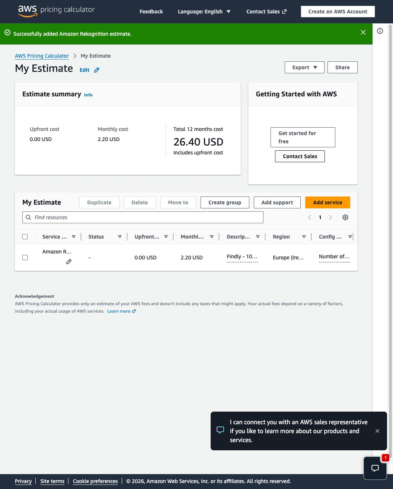
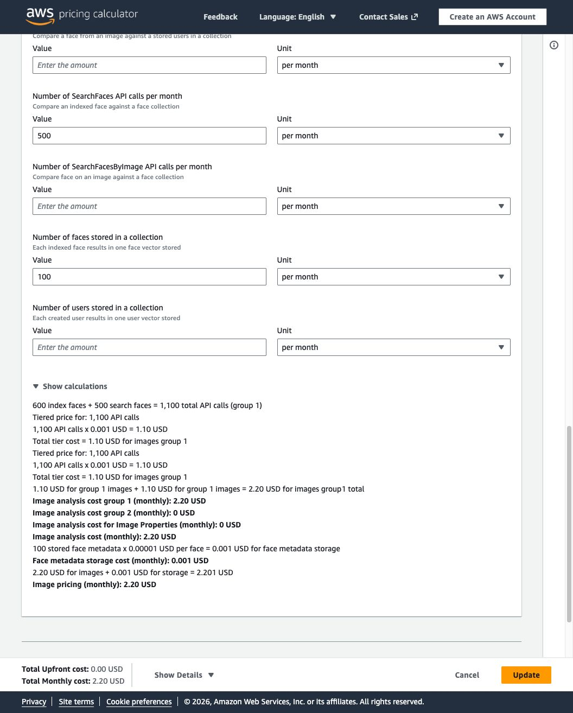

# Modelo paramétrico de cargos por un mes de actividad

**Consulta de tarifas:** 25-10-2026. **Región de aplicación:** `eu-west-1`; CloudFront se tasa en Europa. **Moneda:** USD antes de IVA. Los datos y tarifas reducidos están en `inputs.json`; ejecución offline reproducible con Python estándar:

```sh
python3 calculate.py
```

El script genera `costs.csv`. El campo total se llama `total_modeled_services_usd`: incluye los servicios y operaciones nombrados en este modelo. No representa el coste AWS completo ni una factura. El contraste parcial con AWS Pricing Calculator se documenta al final; no valida el total de servicios.

## Escenarios

| Escenario supuesto                            | Rekognition | CloudWatch | Resto de servicios | Total modelado |
| --------------------------------------------- | ----------: | ---------: | -----------------: | -------------: |
| 20 asistentes / 100 fotos                     |     $0.2202 |    $1.0120 |            $0.1037 |    **$1.3359** |
| 100 asistentes / 500 fotos                    |     $1.1010 |    $1.0480 |            $0.2747 |    **$2.4237** |
| 100 asistentes / 500 fotos / 10 altas tardías |    $11.1010 |    $1.9600 |            $0.3277 |   **$13.3887** |

No se descuenta ninguna cuota gratuita ni crédito. Esto incluye cargos que podrían ser cero en una cuenta elegible. En particular, CloudFront tiene asignaciones gratuitas y AWS ofrece una franquicia agregada de transferencia; ambas se ignoran intencionadamente. El scheduler se tasa a su coste unitario pagado aunque el catálogo muestre un tramo incluido de 14 millones de invocaciones. Precios S3, DynamoDB, Lambda, API Gateway, SQS, SNS, SES, CloudWatch, Cognito, Rekognition y scheduler provienen de los catálogos públicos AWS Price List reducidos en `inputs.json`; se preservan URL, SKU, unidad y fecha de consulta. CloudFront utiliza su catálogo global por distribución y la fila de edge location Europe. Egress S3 usa la página oficial de Data Transfer Out (tarifa publicada $0.09/GB); el catálogo EC2 regional completo de ~442 MB no se descargó. Egress CloudFront se tasa de su catálogo de Europa ($0.085/GB hasta 10 TB). No hay CloudFront para fotos del evento: la SPA va por CloudFront, y las fotos se descargan desde S3.

## Supuestos de actividad y arquitectura

Los escenarios comparten estos supuestos: cada foto/evento de 3 MiB, selfie de 0.5 MiB; una cara media por foto; cinco coincidencias guardadas por asistente; 5 descargas de fotos por asistente; 4 usuarios MAU en Cognito Essentials (supuesto fijo, no deducido del pool desplegado); un correo manual por asistente, cero adjuntos; 10 MiB de SPA en S3; 2 MiB de activos descargados por visitante (asistente más dos organizadores), 25 solicitudes HTTPS CloudFront/visitante, 80% cache hit; un despliegue mensual de SPA con 10 PUT de origen. CloudFront añade cargos por las 25 solicitudes y 2 MiB por visitante; los cache misses generan S3 GET, pero S3 a CloudFront no añade transferencia de origen al total. Los originales y descargas de fotos de evento cuentan como egress S3 sin CDN.

El camino ordinario de foto realiza una llamada Rekognition `IndexFaces` y una llamada `SearchFaces` por cara detectada; cada selfie inscrita añade una llamada `IndexFaces`. Cada registro tardío recorre nuevamente N fotos (backfill con página de 25), por lo que el análisis supone `A selfies + N×(1+R)×(1+F)` unidades Group 1. El almacenamiento de metadatos de las caras de inscripción se calcula como A vectores-mes; caras temporales de evento se eliminan y no se incluyen como almacenamiento. Se omiten reintentos de búsqueda y `DeleteFaces` no es análisis facturado en el SKU Group 1 utilizado.

DynamoDB: cada foto 500 bytes, inscripción 1 KiB, match/espejo 1 KiB cada uno; cinco matches por persona. Las lecturas consistentes del backfill suman bytes por página, redondeando hacia arriba por bloques de 4 KiB por página, además de una lectura consistente de la inscripción por página. Para cada match se imputan dos ConditionCheck transaccionales (4 RRU en total) y una consulta GSI eventual (0.5 RRU); el par transaccional de `Put` usa 4 WRU hasta 1 KiB/item. Se excluyen overhead del índice, tokens, claves/atributos extra y otras rutas. Storage DynamoDB se valora con el precio catalogado $0.283/GB-mes sobre todo el volumen, aunque el SKU cobra más allá de 25 GB, para no descontar cuota incluida.

Lambda: API 150 ms/256 MiB por llamada; flujo normal de imagen 1.2 s/512 MiB por foto; inscripción 2 s/512 MiB; handler backfill suma 0.3 s/512 MiB por página, más el procesamiento de cada foto; worker de galería 2 s/256 MiB por recipiente y un invoke por correo; purger 30 invocaciones mensuales de 1 s/512 MiB. Se considera un invoke por foto y página de SQS standard, sin batch aggregation; email FIFO tiene una solicitud send, receive y delete por destinatario y un worker por email. Los costes CloudWatch logs son volumen supuesto total por escenario (0.02, 0.08, 0.10 GiB) que cubre todas estas funciones, retenido un mes. Se supone cuatro alarmas métricas (dos del matching/backfill y dos del trabajo/feedback de galería por Terraform), y dos métricas personalizadas activas para los filtros de inscripción/polling; en sensibilidad se modelan cinco métricas personalizadas (dos filtros y hasta tres Stage). SNS no publica si no hay alarma o bounce/complaint; se presupone cero eventos, así que no se cuenta entrega SNS. EventBridge Scheduler ejecuta el purger 30 veces al mes.

Gateway es HTTP API por `protocol_type = HTTP`. Cognito modela Essentials a $0.015/MAU y carga los cuatro MAUs supuestos sin cuota gratis; no se afirma que sea el plan del user pool real. SES usa el SKU directo `EU-Recipients` ($0.10/1000 recipientes vía `SendEmail`/`SendRawEmail`), no un producto Mail Manager ni un plan SES Essentials. La selección real de plan SES es desconocida y puede cambiar la tarifa por envío; el modelo no identifica el plan desplegado. Sensibilidad Essentials sería $0.16/1000 destinatarios (solo +$0.0012, +$0.0060, +$0.0060 en escenarios). El plan operativo autorizado de correo y configuración no se valida mediante este modelo.

## Partidas fuera del total modelado

Dominio y DNS no se incluyen por falta de factura; soporte, cargos de publicación/transferencia de Terraform y CI, compras de créditos, variación de duración y tamaño de imágenes, egreso a destinos no modelados, KMS u opciones de cifrado administradas, retries/DLQ, SNS alarmas activas o feedback SES con rebotes/quejas, coste de SES plan real, datos y tráfico web superiores al supuesto, impuestos y cargos no listados. Por tanto, denominarlo **estimación de los servicios modelados**, no total AWS. El dominio es una partida pendiente con cotización/factura.

## Gasto declarado por el equipo

El 26 de octubre el equipo comunica 1,41 EUR de Rekognition y 0,30 EUR de S3
(1,71 EUR en esas partidas), dentro de su límite de gasto de capa gratuita.
No se recibió factura ni periodo: se conserva como declaración, no como
conciliación contable con este modelo en USD.

## Serie de costes y previsiones aportada por el equipo

Las [capturas y transcripción por mes](team-cost-forecast.md) añaden los costes
reales comunicados de agosto/septiembre y previsiones de octubre/noviembre.
La previsión de noviembre suma 2,986 USD (2,99 USD redondeados). Se conservan
moneda, naturaleza y alcance no confirmado de la fuente; no se fusiona con
la declaración en EUR ni se presenta como factura conciliada del modelo.

## Contraste parcial con AWS Pricing Calculator — 26 de octubre

[Estimación guardada de Rekognition](https://calculator.aws/#/estimate?id=052dd6f3544a78368ff9a2097138042393c4437e),
Europe (Ireland), un mes, 600 IndexFaces, 500 SearchFaces y 100 rostros almacenados.
Son cantidades hipotéticas, sin datos personales ni recursos desplegados.

La interfaz devuelve 2,20 USD (2,201 USD en el desglose), frente a 1,101 USD
calculados con la tarifa Group 1 del manifiesto. El desglose de la interfaz
repite dos veces la misma cantidad de 1.100 operaciones a 0,001 USD y suma
1,10 + 1,10 USD; los metadatos faciales coinciden en 0,001 USD. Se conserva
esta discrepancia observable, sin afirmar que sea una tarifa adicional ni
modificar el modelo para forzar concordancia. Requiere aclaración antes de
usar la estimación como validación del coste esperado. El enlace es público
y su vigencia indicada por AWS es de un año.





La calculadora guardada solo incluye Rekognition; los demás servicios tienen
entradas reproducibles en inputs.json y costs.csv, pero no están contrastados
con una estimación completa exportada de Calculator.
