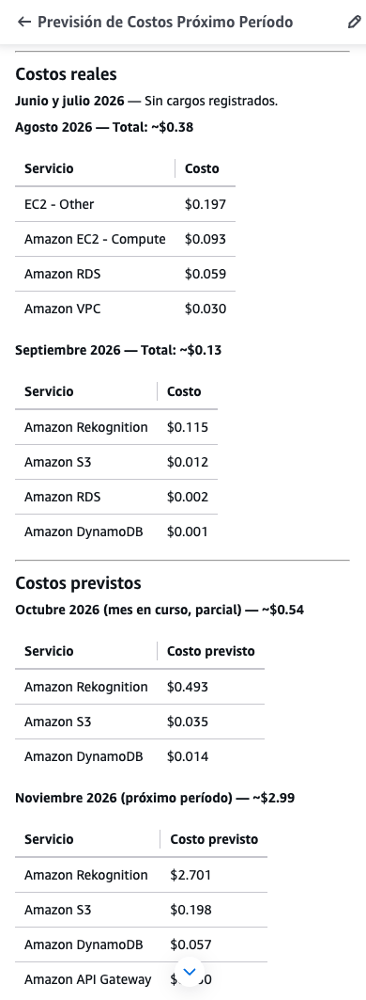
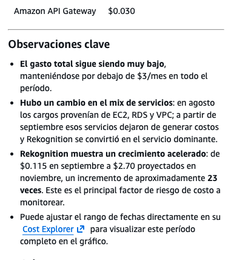

# Costes reales comunicados y previsiones aportadas por el equipo

Recibido el 26 de octubre de 2026. Fuente: dos capturas de un resumen titulado
«Previsión de Costos Próximo Período». Se transcriben sus partidas en USD.
El equipo confirma que el resumen abarca toda la cuenta AWS. Las capturas
aportan una transcripción de partidas; contrastarlas con la factura o una
exportación de Cost Explorer requiere filtros, fecha de extracción, impuestos,
créditos, región y método de previsión.

| Periodo 2026  | Naturaleza indicada    | Suma de partidas mostradas (USD) | Partidas (USD)                                                  |
| ------------- | ---------------------- | -------------------------------: | --------------------------------------------------------------- |
| Junio y julio | Sin cargos registrados |                                — | Según el resumen; sin partidas.                                 |
| Agosto        | Real comunicado        |                            0,379 | EC2 - Other 0,197; EC2 - Compute 0,093; RDS 0,059; VPC 0,030.   |
| Septiembre    | Real comunicado        |                            0,130 | Rekognition 0,115; S3 0,012; RDS 0,002; DynamoDB 0,001.         |
| Octubre       | Previsión parcial      |                            0,542 | Rekognition 0,493; S3 0,035; DynamoDB 0,014.                    |
| Noviembre     | Previsión              |                            2,986 | Rekognition 2,701; S3 0,198; DynamoDB 0,057; API Gateway 0,030. |

Las sumas se calculan sobre los valores visibles ya redondeados; no recuperan
la precisión original del sistema de facturación. La transcripción estructurada
está en [team-cost-forecast.json](team-cost-forecast.json).

## Interpretación y límites

- El mayor importe mensual mostrado es la previsión de noviembre, 2,986 USD,
  redondeada a 2,99 USD. Frente al objetivo de demo de 5 USD/mes, el margen
  aritmético es 2,014 USD (40,28 %); el saldo disponible y el cumplimiento efectivo del presupuesto requieren
  conciliar la facturación.
- Rekognition representa aproximadamente el 90,46 % de esa previsión. Sus
  2,701 USD son 23,49 veces los 0,115 USD comunicados para septiembre. La
  comparación mezcla un dato real comunicado con una previsión: expresa
  la relación entre el gasto comunicado y el importe previsto.
- Septiembre todavía incluye RDS (0,002 USD), aunque muy por debajo de agosto.
  Confirmar la retirada de EC2/VPC requiere revisar el inventario de recursos.
- Los cargos históricos de EC2, RDS y VPC corresponden al resumen de toda
  la cuenta AWS, según confirmación del equipo. Su atribución individual a
  Findly requiere un desglose por recursos o etiquetas; la arquitectura
  vigente del proyecto se mantiene descrita en sus diagramas e IaC.
- La serie de cuenta en USD y la declaración previa de 1,41 EUR de
  Rekognition y 0,30 EUR de S3 conservan su procedencia. Conciliar ambas
  requiere identificar periodo, moneda y partidas atribuibles al proyecto.
- El modelo paramétrico, el contraste parcial de Calculator y la previsión
  de cuenta mantienen sus propias tarifas, volúmenes y supuestos para
  facilitar su comparación.

## Capturas aportadas

