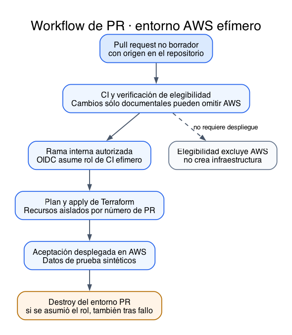
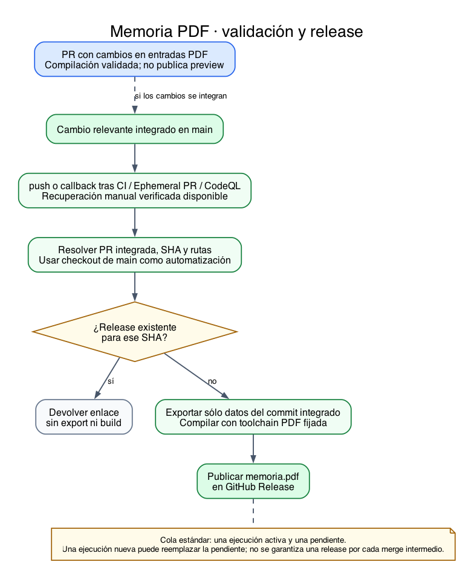
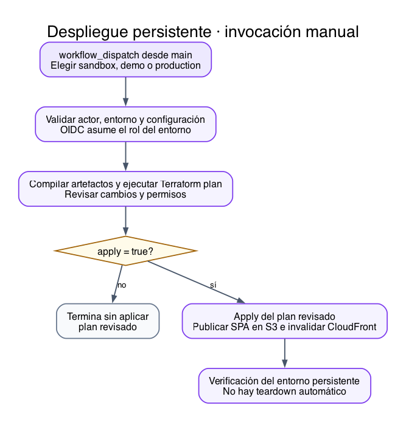
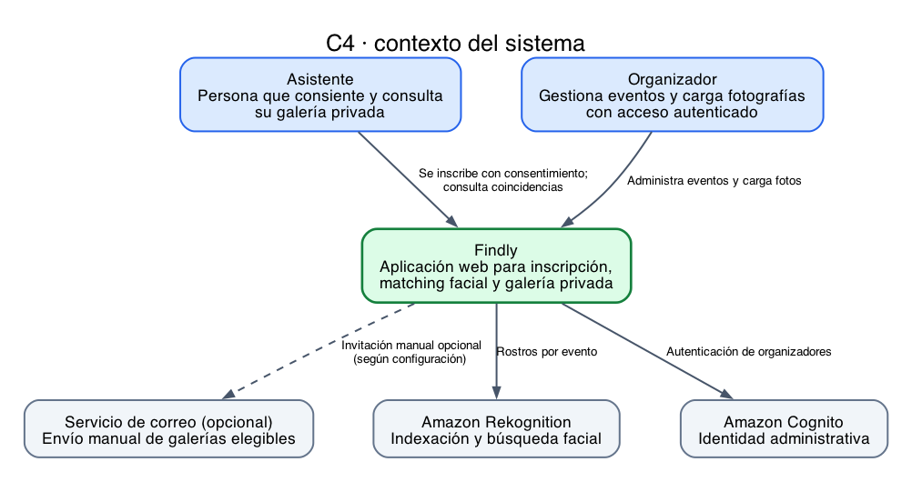
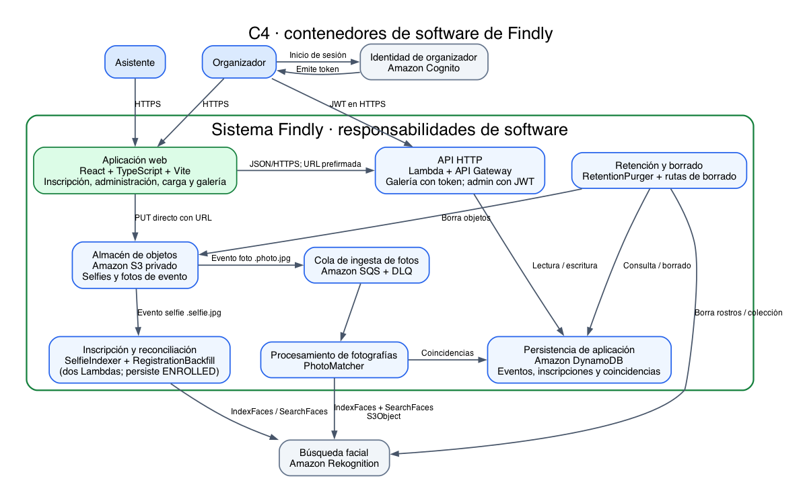
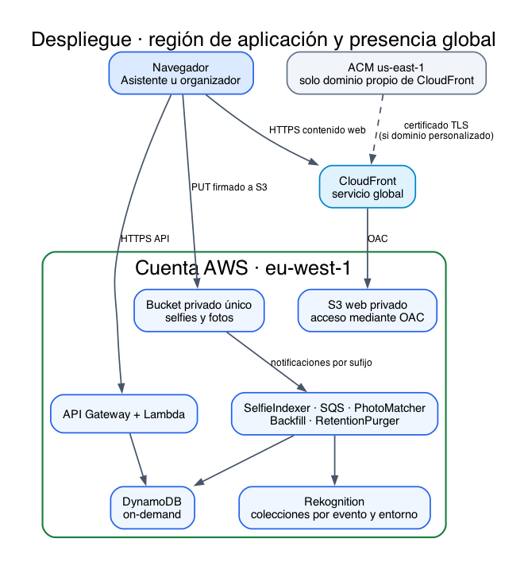
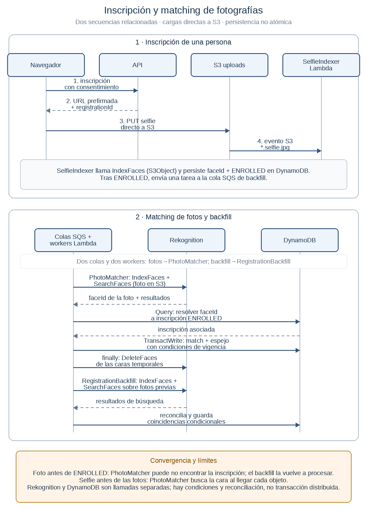

<!--
Compilar (recomendado): make pdf   /   make docx   (ver Makefile)

Compilar a mano:
  pandoc memoria-postgrado.md -o memoria.pdf --pdf-engine=xelatex \
    --filter pandoc-crossref --include-before-body=portada.tex
  pandoc memoria-postgrado.md -o memoria.docx \
    --filter pandoc-crossref --include-before-body=portada.tex

`include-before-body` debe pasarse como flag de línea de comandos, no como
clave del YAML: como metadato no inserta el fichero.

Imágenes: {#fig:id}
Regenerar diagramas: make diagrams (requiere graphviz y el venv de requirements.txt)
-->

# Resumen {.unnumbered}

Findly aborda la localización y entrega de fotografías de eventos mediante
coincidencias faciales, previa inscripción y consentimiento explícito de
personas adultas. El equipo desarrolla un prototipo cloud con una interfaz
React y servicios gestionados de AWS: Lambda para la lógica, DynamoDB para
los datos, S3 para imágenes, Rekognition para la búsqueda facial y SQS para
desacoplar el procesamiento. Terraform describe la infraestructura y GitHub
Actions automatiza su verificación en entornos efímeros.

La contribución del proyecto es integrar estos servicios en un recorrido
trazable de inscripción, matching, galería privada y borrado. El diseño resuelve
el acceso inverso fotografía–participante mediante ítems espejo y limita las
escrituras tardías mediante una barrera de borrado. La evaluación combina
pruebas locales, integración emulada y escenarios ejecutados en AWS, cuyo
alcance se diferencia explícitamente. Los ensayos históricos de borrado
registraron 2,020 s y 3,082 s para fotografías con 100 y 1.000 coincidencias.
Estos resultados no acreditan percentiles de carga ni precisión estadística
del reconocimiento. Persisten objetivos de rendimiento y pruebas concurrentes
pendientes. El sistema está desplegado con dominio registrado, según
confirmación del equipo, y se presentará mediante una demostración durante
la defensa. La memoria aporta decisiones, evidencias y límites de operación
reproducibles, sin atribuir al prototipo garantías de servicio no medidas.

**Palabras clave:** computación en la nube, serverless, reconocimiento facial,
privacidad, infraestructura como código, evaluación experimental.

# Estado de referencia de esta memoria {.unnumbered}

Revisión documental: 25 de octubre de 2026. El equipo confirma que la aplicación
está desplegada y funcional en [www.findly.barcelona](https://www.findly.barcelona),
con dominio registrado, y que realizará una demo durante la defensa. Esta
confirmación describe disponibilidad funcional; no sustituye una campaña de
rendimiento ni identifica por sí sola la revisión exacta de cada Lambda
desplegada. Una comprobación HTTPS de la página pública realizada el
25 de octubre devolvió HTTP 200; solo acredita la entrega del documento web.
La defensa todavía no se presenta como una prueba realizada.

La memoria conserva las fechas y entornos de cada evidencia. La corrección de
borrado y matching integrada en `main` mediante #168 superó el recorrido AWS
efímero y su destrucción; las carreras deterministas y el TTL lógico conservan
aceptación AWS específica pendiente. El despliegue funcional confirmado no
extiende automáticamente esa aceptación a todos los casos concurrentes.
La matriz de requisitos y la sección experimental distinguen resultados
medidos, confirmaciones del equipo y validaciones todavía pendientes.

# Introducción

## Contexto y problema

En cualquier evento con un número apreciable de asistentes —una jornada
profesional, una boda, una carrera popular, un festival— se generan
rápidamente miles de fotografías repartidas entre varios fotógrafos y
cámaras. El problema que ese volumen plantea no es técnico en origen sino de
usabilidad: cada asistente aparece disperso en un puñado de esas fotos, pero
localizarlas exige revisar manualmente carpetas enteras, confiar en que
alguien las etiquete a mano o resignarse a no encontrarlas nunca. Las
soluciones habituales —enviar un enlace a todo el álbum, pedir que cada
persona busque su propia cara entre cientos de imágenes, o compartir
carpetas abiertas sin ningún control de acceso— no escalan y, además, tratan
como públicas fotografías que contienen datos personales de terceros.

Findly nace para resolver ese problema concreto con una propuesta de valor
sencilla: si un asistente acepta explícitamente que su rostro se use para
este fin y aporta una fotografía de referencia (una selfie), el sistema
puede indexar ese rostro, compararlo automáticamente contra las fotos que el
organizador del evento vaya subiendo, y ofrecerle un enlace privado y temporal con las imágenes coincidentes.
El acceso depende de la posesión del enlace; no acredita la identidad de quien
lo utiliza ni impide que lo comparta. El
consentimiento no es un trámite legal añadido a posteriori: es la condición
que habilita todo el flujo. Una inscripción sin selfie y consentimiento no habilita la búsqueda de su
galería. Las fotografías grupales pueden contener terceros: su indexación
temporal y su exposición se analizan en la sección de amenazas.

La segunda motivación del proyecto, inseparable de la primera, es demostrar
que este tipo de servicio puede construirse en la nube pública con una
arquitectura que no obligue a pagar por capacidad reservada ni a operar
infraestructura propia. Un evento es, por definición, una carga de trabajo
puntual y de corta duración: tiene sentido que el coste de la plataforma sea
proporcional al uso real que hace de ella, no una factura fija mensual
independientemente de si hay un evento activo o no.

## Estado del arte y alternativas

La entrega personalizada de fotografías de eventos ya existe como categoría de
producto. La revisión siguiente, realizada el 25 de octubre de 2026, compara
capacidades declaradas por sus proveedores; no es una prueba independiente
de precisión, seguridad ni coste total.

<!-- prettier-ignore -->
| Alternativa | Aportación | Diferencia relevante para Findly |
| --- | --- | --- |
| Álbum compartido y selección manual | Recopilar y distribuir fotos mediante un enlace común. | Evita la identificación biométrica, pero traslada la búsqueda al asistente y puede exponer el álbum completo. |
| Waldo Photos [26] | Galerías de eventos y distribución de coincidencias mediante reconocimiento facial. | Servicio comercial completo; Findly estudia la construcción y verificación de su propio recorrido cloud. |
| SpotMyPhotos [27] | Inscripción voluntaria con selfie y entrega personal, inmediata o tras revisión. | Permite comparar el flujo de participación y entrega, sin asumir equivalencia de implementación. |
| Photier [28] | Localización de fotos de eventos a partir de una selfie. | Confirma una necesidad de mercado existente; sus planes no son una medida del coste AWS de Findly. |

En infraestructura, Rekognition ofrece indexación y búsqueda en colecciones
[1–2]. Azure AI Face es una alternativa gestionada con identificación facial
sujeta a condiciones de acceso [29]. Google Cloud Vision ofrece detección de
rostros, que no debe confundirse con identificación de personas [30].
Autogestionar un modelo exigiría seleccionar y evaluar el modelo, ejecutar la
inferencia y mantener su índice, además de implementar el mismo ciclo de
consentimiento y borrado. Sin un experimento comparable no se afirma que una
alternativa sea más barata ni más precisa.

La aportación académica de Findly no es inventar el reconocimiento facial ni
demostrar superioridad comercial. Es diseñar y verificar una integración
serverless reproducible, estudiar sus fallos parciales y relacionar la
privacidad y el coste con decisiones concretas. Kubernetes no se incorpora
porque el alcance no requiere operar contenedores persistentes; esta elección
debe evaluarse por su adecuación al problema y a los objetivos docentes.

## Alcance del MVP

El producto mínimo viable de Findly cubre el recorrido completo de un
asistente y de un organizador de evento, desde la inscripción hasta el
borrado de los propios datos:

- Un asistente accede a la página pública de un evento, acepta el
  consentimiento biométrico y de términos, y sube una selfie mediante una
  URL de carga firmada con escritura condicional.
- Una función Lambda indexa el rostro en Amazon Rekognition y expone el
  estado de la inscripción mientras el navegador lo consulta por sondeo.
- Un organizador, autenticado mediante Cognito en el entorno, crea el evento y carga las fotografías a medida que las va
  teniendo disponibles.
- El sistema compara cada fotografía nueva contra los rostros inscritos y
  construye, para cada asistente, una galería privada de coincidencias.
- El asistente recibe un enlace temporal a su galería y puede, en cualquier
  momento, solicitar la retirada completa de sus datos.

Estas capacidades se validan contra un conjunto de métricas de éxito
cuantitativas (sección de requisitos no funcionales), se limitan a una única
región de AWS y se diseñan desde el principio para operar dentro de los límites
de la capa gratuita o de un presupuesto de demostración acotado, sin capacidad
de cómputo o red dedicada. El almacenamiento retenido y las alarmas pueden
generar consumo sin tráfico. Todas las imágenes usadas durante el desarrollo y
las pruebas son sintéticas o han sido aportadas con autorización explícita del
equipo: en ningún momento se han tratado fotografías reales de terceros sin
consentimiento.

## Elementos excluidos del alcance

Un proyecto de este tipo invita a ampliarse en direcciones que, aunque
técnicamente posibles, cambiarían su naturaleza o su perfil de riesgo de
forma que el equipo decidió excluir explícitamente desde el planteamiento
inicial:

- Vigilancia o reconocimiento facial en vídeo en tiempo real: Findly sólo
  procesa imágenes fijas subidas voluntariamente, nunca una transmisión de
  cámara continua.
- Tratamiento de menores de edad, incluso con autorización de un tutor: queda
  fuera del alcance de este MVP.
- Alta disponibilidad multirregión o cualquier garantía de continuidad de
  servicio propia de un sistema de producción crítico.
- Bases de datos relacionales gestionadas (RDS), instancias de cómputo
  reservado (EC2), redes privadas virtuales dedicadas (VPC), pasarelas NAT o
  clústeres de orquestación de contenedores (EKS), por las restricciones de
  alcance y operación del MVP. Se evita aprovisionar capacidad dedicada; no
  se atribuye una misma tarifa a todos los servicios de esa lista.
- Comunicaciones masivas por correo electrónico o SMS como mecanismo de
  marketing o notificación no solicitada.

Esta exclusión no es una limitación técnica sino una decisión de diseño: deja
fuera del perímetro del proyecto exactamente los componentes que introducirían
coste fijo, mayor superficie de exposición de datos sensibles o un cambio de
naturaleza del servicio hacia la vigilancia.

## Requerimientos del proyecto

### Requerimientos funcionales

El sistema debe cumplir, como mínimo, los siguientes requisitos funcionales:

1. Un asistente puede aceptar el consentimiento biométrico y cargar una
   selfie mediante una URL de Amazon S3 firmada de una sola escritura; una
   función Lambda indexa el rostro en Amazon Rekognition y el estado de la
   inscripción (pendiente de carga, en proceso, inscrito o fallido) queda
   disponible para que el cliente lo consulte por sondeo.
2. Un organizador, autenticado, puede crear eventos y cargar fotografías; una
   función Lambda, desacoplada mediante una cola de mensajería, busca
   coincidencias faciales con un umbral de similitud mínimo exigente.
3. El asistente recibe una galería privada construida con URLs firmadas de
   corta duración y puede solicitar en cualquier momento la retirada
   completa de sus datos —derecho al olvido—, lo que implica borrar el
   registro, las coincidencias encontradas, el token de acceso, la imagen
   original y el identificador facial indexado.
4. Cada evento y los datos que genera caducan según una política de
   retención configurable, con un mínimo de demostración de siete días.

### Requerimientos no funcionales y pilares del Well-Architected Framework

Los requisitos no funcionales de Findly se expresan como una matriz de
métricas de éxito con un umbral cuantitativo y una fuente de telemetría
identificada para cada una, de modo que ninguna de ellas quede como una
aspiración sin forma de comprobarse:

<!-- prettier-ignore -->
| Métrica | Fuente | Umbral objetivo |
| --- | --- | --- |
| Inscripción completa | CloudWatch / DynamoDB | > 98 % de solicitudes completadas |
| Umbral de similitud | Rekognition / DynamoDB | Similitud >= 95,0 % |
| Procesamiento de selfie | CloudWatch Metrics | < 3 s desde la carga en S3 hasta el estado "inscrito" |
| Respuesta de galería | CloudFront / API Gateway | p95 < 500 ms |
| Control de presupuesto (FinOps) | AWS Budgets | 100 % dentro de 0 $ (capa gratuita/sandbox) o 5 $ (demo) |
| Borrado conforme a RGPD | Registros de auditoría | 100 % de los datos purgados tras caducidad o solicitud |

: Matriz de métricas de éxito del MVP {#tbl:metricas}

Estos umbrales son objetivos. El umbral de similitud del 95 % no es una
precisión estadística del 95 %. La aceptación AWS de #87 verifica
`ENROLLED`, pero su cronómetro no aísla el intervalo S3 PUT → `ENROLLED`.
Por ello no acredita ni refuta el objetivo < 3 s. Tampoco hay una campaña
de carga que acredite p95 < 500 ms o > 98 % de éxito agregado. El borrado y el
matching están demostrados en escenarios específicos, sin extrapolarlos al 100 %
de todos los casos ni a una factura completa dentro del presupuesto.

Más allá de estos umbrales cuantitativos, el proyecto adopta explícitamente los
seis pilares del AWS Well-Architected Framework como guía para las decisiones
de arquitectura [14–16]. Esta correspondencia no
constituye una certificación ni una revisión formal completa de AWS
Well-Architected; los resultados y límites de verificación se distinguen de los
objetivos de diseño.

- **Excelencia operativa.** La base del repositorio estandariza linting, tipado
  estricto en TypeScript y un conjunto único de scripts de verificación que se
  ejecutan igual en local y en integración continua; las puertas de calidad
  automatizadas combinan comprobaciones de tipos, pruebas unitarias, pruebas de
  extremo a extremo y validación de infraestructura como código en trabajos
  paralelos, y un runbook de demostración ejecutable paso a paso documenta cómo
  operar el sistema.
- **Seguridad.** Es, con diferencia, el pilar con más decisiones asociadas: el
  alcance excluye desde el inicio datos de menores y vigilancia masiva; el
  acceso a los buckets de almacenamiento está bloqueado a nivel de servicio y
  sólo se concede mediante URLs firmadas de vida corta; la identidad de los
  organizadores se gestiona con un proveedor de identidad gestionado y el
  autorizador de tokens se valida en la propia puerta de entrada de la API, no
  dentro de cada función; y la integración entre GitHub Actions y AWS se
  autentica mediante un protocolo de identidad federada sin ninguna clave de
  acceso de larga duración almacenada como secreto.
- **Fiabilidad.** La ingesta de fotografías se desacopla mediante una cola de
  mensajería con una cola de mensajes fallidos, de modo que los picos de carga y
  los fallos transitorios puedan gestionarse con reintentos y redrive; el procesamiento de cada
  rostro es idempotente ante reintentos.
- **Eficiencia del rendimiento.** El modelo de datos usa una única tabla con un
  diseño de tabla única y dos índices secundarios globales; uno permite resolver
  mediante un índice la pregunta "¿qué registro corresponde a este rostro?", sin
  recurrir nunca a un recorrido completo de la tabla.
- **Optimización de costes.** No se aprovisionan servidores, RDS ni NAT. El
  cómputo y las peticiones escalan con el uso; el almacenamiento retenido y las
  alarmas pueden facturar sin tráfico. AWS Budgets configura una alerta al 80 %
  del presupuesto, no un límite de gasto ni una parada automática. La entrega
  SNS está verificada; no se ha observado el disparo propio de Budgets ni se
  acredita aquí una factura completa del sistema.
- **Sostenibilidad.** Al facturar y ejecutar por petición, la arquitectura no
  mantiene capacidad de cómputo reservada e infrautilizada a la espera de
  tráfico, a diferencia de un servidor encendido permanentemente; los entornos
  de prueba se destruyen por completo al finalizar cada ejecución de integración
  continua, de modo que no queda infraestructura ociosa entre una comprobación y
  la siguiente.

## Matriz central de requisitos y resultados

La matriz resume el estado al 25 de octubre de 2026. «AWS» identifica ensayos
históricos en servicios reales; «local» no acredita ese entorno. Una
confirmación del equipo se distingue de un artefacto de medición. Las fuentes
enlazadas conservan los escenarios, ejecuciones y límites de cada resultado.

<!-- prettier-ignore -->
| Requisito y spec | Resultado y entorno | Estado / evidencia |
| --- | --- | --- |
| Inscripción y consentimiento (03, 06, 09) | Recorrido consentido hasta `ENROLLED` ejercitado en AWS. | Funcional verificado: [#87](../../evidence/issue-87-matching-convergence.md). No mide éxito agregado. |
| Administración y carga (04, 05, 23) | Cognito, firma de cargas y ciclo de fotos/eventos comprobados. | Escenarios AWS: [#89](../../evidence/issue-89-admin-event-photo-lifecycle.md). Catálogo administrativo compartido. |
| Matching en ambos órdenes (07, 21) | Selfie antes y después de fotos; paginación de 26 fotos. | AWS: [#87](../../evidence/issue-87-matching-convergence.md). Doble escritura DynamoDB/SQS sigue limitada. |
| Galería y descarga (08, 22) | Acceso privado, actualización, estados de token y descarga. | [#88](../../evidence/issue-88-gallery-refresh-download-sharing.md). Límite de descarga en WebKit; no acredita p95. |
| Borrado y retención (09, 23) | Eliminación y purga verificadas en casos concretos de AWS. | [#70](../../evidence/issue-70-erasure-retention.md), [#89](../../evidence/issue-89-admin-event-photo-lifecycle.md). No prueba universal. |
| Barrera de foto y TTL lógico (21, 23) | Corrección integrada; carreras deterministas en local, smoke funcional AWS. | [#166](../../evidence/issue-166-photo-matching-barrier.md): aceptación AWS específica pendiente. |
| Correo manual (20) | Nueve escenarios AWS, recibo de un buzón y confirmación manual multiproveedor. | [#98](https://github.com/upc-malvaviscos/findly/issues/98#issuecomment-6361540360) cerrada; fuentes de evidencia diferentes. |
| CI y entorno efímero (13–16) | Aprovisionamiento, pruebas y limpieza en ejecuciones identificadas. | [#166](../../evidence/issue-166-photo-matching-barrier.md): smoke y 147 recursos destruidos. No acredita despliegue idéntico en producción. |
| Memoria y publicación (17) | PDF compilado y release automática verificada. | [#186](../../evidence/issue-186-memoria-pdf-releases.md); revisión documental actual en [#192](https://github.com/upc-malvaviscos/findly/issues/192). |
| Inscripción > 98 % y galería p95 < 500 ms (00) | No hay muestra agregada acreditada en las fuentes revisadas. | Pendiente; método definido en evaluación experimental. |
| Selfie < 3 s y similitud $\geq$ 95 % (00) | Sin intervalo de selfie válido; similitud configurada en 95 %. | Tiempo objetivo no demostrado; similitud no equivale a precisión estadística. |
| Presupuesto de demo $\leq$ 5 USD (00, 12) | Modelo estimado y canal SNS probado; sin factura completa atribuida. | Estimación separada de gasto real. Budgets no actúa como límite duro. |

: Requisitos, evidencia y límites de aceptación {#tbl:trazabilidad}

## Gestión interna del proyecto

### Equipo y contribuciones verificables

Anyul Rivas, Renato Luzuriaga, Martí Fabregat Pous y Santiago Oliver Surinyach
trabajaron sobre un backlog compartido. La siguiente tabla identifica ejemplos
de entregables trazables a sus cuentas de GitHub; no atribuye el desarrollo
completo de un módulo a una sola persona ni utiliza el número de commits como
medida de esfuerzo.

<!-- prettier-ignore -->
| Integrante | Contribuciones documentadas | Evidencia representativa |
| --- | --- | --- |
| Anyul Rivas | Controles de despliegue y correo, barrera de borrado y automatización de la memoria. | [#102](https://github.com/upc-malvaviscos/findly/pull/102), [#168](https://github.com/upc-malvaviscos/findly/pull/168), [#187](https://github.com/upc-malvaviscos/findly/pull/187). |
| Renato Luzuriaga | Inscripción pública, matching en ambos órdenes, benchmark de fan-out y reintento de cargas. Diagnóstico de errores del ensayo SES. | [#60](https://github.com/upc-malvaviscos/findly/pull/60), [#129](https://github.com/upc-malvaviscos/findly/pull/129), [#141](https://github.com/upc-malvaviscos/findly/pull/141), [#149](https://github.com/upc-malvaviscos/findly/pull/149), [diagnóstico](https://github.com/upc-malvaviscos/findly/issues/98#issuecomment-6222459968). |
| Martí Fabregat Pous | Observabilidad y FinOps, administración de eventos/fotos, pruebas de descarga y sincronización de resultados académicos. | [#64](https://github.com/upc-malvaviscos/findly/pull/64), [#120](https://github.com/upc-malvaviscos/findly/pull/120), [#130](https://github.com/upc-malvaviscos/findly/pull/130), [#159](https://github.com/upc-malvaviscos/findly/pull/159). |
| Santiago Oliver Surinyach | Cobertura de integración del indexador con S3/DynamoDB emulados y Rekognition simulado; preparación del bloque funcional y demo de la defensa. | [#72](https://github.com/upc-malvaviscos/findly/pull/72), [preparación de defensa](../../evidence/2026-10-23-code-truth-sync.md). |

La asignación actual de issues complementa la autoría de PR: Anyul tiene
asignadas, entre otras, #1/#2/#4/#5/#9/#14/#16/#17 y #86; Renato, #11/#22/#46/#47/#49/#61/#87/#88; Martí, #3/#6/#8/#10/#12/#13/#15/#18
y #89/#105/#107; Santiago, #7/#45/#121. Asignación no implica autoría
exclusiva de la implementación ni prueba por sí sola que el trabajo esté cerrado.

Como aproximación a la actividad de desarrollo solicitada por el equipo, el
[recuento reproducible](../../evidence/team-activity-2026-10-26.json) sobre
`075f76c` contabiliza commits sin merges y excluye 22 commits del bot:

<!-- prettier-ignore -->
| Integrante | Commits con autor registrado | Issues asignadas |
| --- | --- | --- |
| Anyul Rivas | 263 | 14 |
| Renato Luzuriaga | 39 | 8 |
| Martí Fabregat Pous | 58 | 11 |
| Santiago Oliver Surinyach | 0 | 3 |

Este indicador no permite convertir commits a horas ni repartir el esfuerzo
real en porcentajes. La PR #72 fue abierta por Santiago, pero los commits que
contiene están atribuidos a Anyul: un cero en esta columna no significa ausencia
de contribución. También quedan fuera revisiones, pruebas manuales, coordinación
y preparación de la defensa. No se dispone de un registro de horas individuales.

### Cronograma observado y desviaciones

El primer commit conservado es `397abdf`, del 26 de junio de 2026
(`Initial commit`); ese es el inicio observable del repositorio. El backlog
y el desarrollo sistemático se documentan desde el 3 de septiembre.
El cronograma se reconstruye a partir de hitos fechados, no de horas-persona.
La secuencia prevista por las specs fue fundación, producto, plataforma y
validación; las auditorías y los fallos observados introdujeron iteraciones.

<!-- prettier-ignore -->
| Periodo | Hito y evidencia | Desviación o aprendizaje |
| --- | --- | --- |
| 26 junio 2026 | Primer commit `397abdf`. | Inicio observable del repositorio; no acredita dedicación continua desde esa fecha. |
| 3–19 septiembre 2026 | Backlog inicial, backend real, modos locales y bootstrap ([#1–#18](https://github.com/upc-malvaviscos/findly/issues/18), [#61](https://github.com/upc-malvaviscos/findly/issues/61)). | Separar emulación de validación desplegada; resolver límites del laboratorio académico. |
| 28 septiembre–2 octubre | Auditoría de cierres y aceptación AWS ([#70](../../evidence/issue-checklist-audit.md)). | Reabrir criterios sin evidencia y dedicar trabajo adicional a aceptación real. |
| 4–15 octubre | Demo, dominio y publicación del circuito de correo ([#98](../../evidence/issue-98-ses-production.md)). | Resolver permisos y contratos de ensayo; conservar la autenticación de Cognito. |
| 16–23 octubre | Benchmark de borrado, correcciones y barrera temporal ([#89](../../evidence/issue-89-admin-event-photo-lifecycle.md), [#166](../../evidence/issue-166-photo-matching-barrier.md)). | El timeout y las carreras obligaron a revisar el protocolo; parte de la aceptación concurrente quedó aplazada. |
| 25 octubre | Publicación automática PDF y recuperación administrativa ([#186](../../evidence/issue-186-memoria-pdf-releases.md), [#175](../../evidence/organizer-recovery.md)). | Verificar la entrega documental y el acceso necesario para la demo. |
| Defensa, fecha no consignada | Demo de la aplicación desplegada, anunciada por el equipo. | Actividad prevista; no se contabiliza como aceptación ya ejecutada. |

No se dispone de una línea base fechada de dedicación ni de un registro de
horas por persona. Por ello no se calcula una desviación de esfuerzo o plazo
porcentual: hacerlo a partir de commits produciría una precisión ficticia.
La desviación comprobable es de trabajo: hubo que repetir aceptación,
corregir contratos y sincronizar documentación después de cierres prematuros.

### Metodología de trabajo

Cada tarea sigue el ciclo investigación, plan, implementación y sincronización.
Las especificaciones fijan criterios de aceptación; las issues enlazan el
cambio y su validación; los ADR conservan las decisiones. El código y la
documentación se integran mediante pull requests, con controles automáticos de
calidad y revisión. La evidencia identifica qué se probó y en qué entorno.

La principal desviación metodológica fue cerrar inicialmente tareas con pruebas
locales que no demostraban su funcionamiento desplegado. La auditoría de
[#70](../../evidence/issue-checklist-audit.md) revisó los criterios, reabrió
tareas y exigió aceptación AWS. El aprendizaje fue separar la verificación de
implementación de la aceptación de producto, y revisar el cierre incluso
cuando la integración continua está en verde. Esta práctica permite conservar
pendientes verificables sin presentar una mejora futura como trabajo entregado.

# Cuentas AWS, repositorios e infraestructura versionada

## Gestión de AWS

### Cuentas, organización y permisos

Findly aloja sus cargas de aplicación y datos en una cuenta de AWS y una región,
`eu-west-1`. CloudFront es un servicio global y su certificado ACM se gestiona
en `us-east-1`; esto no constituye una réplica multirregión de los datos de
negocio. La configuración del dominio y esta excepción operativa se documentan
en [ADR-020](../../adr/ADR-020-production-domain-bootstrap.md).

El laboratorio académico impidió completar el bootstrap previsto; el equipo
continuó con una cuenta dedicada. Deben distinguirse dos mecanismos: **S3
Object Lock** protege versiones de objetos frente a eliminación o modificación
durante una retención, mientras que **el bloqueo de estado de Terraform**
coordina ejecuciones concurrentes mediante `use_lockfile=true` y un objeto
`.tflock`. Object Lock no es un requisito del backend utilizado. El bootstrap
de Findly usa versionado, cifrado, bloqueo de acceso público y protección de
borrado; el lockfile aporta exclusión entre operaciones Terraform. La decisión
está recogida en [ADR-009](../../adr/ADR-009-terraform-remote-state-and-environment-isolation.md)
y en la documentación del backend S3 [13].

Dentro de esa cuenta, los tres entornos del proyecto —desarrollo compartido,
demostración y producción— están aislados entre sí mediante prefijos y
claves de estado de Terraform independientes, para reducir errores de selección. Los prefijos no son una frontera de
seguridad por sí solos: el aislamiento depende también de los roles IAM y de
la configuración del backend.

### Gestión de usuarios

El proyecto distingue dos planos de usuario completamente distintos. Los
asistentes al evento no tienen ninguna identidad de usuario propiamente
dicha: su autorización para consultar su galería o borrar sus datos se basa
únicamente en la posesión de un token de acceso opaco, sin necesidad de
registrarse. Los organizadores, en cambio, se autentican contra un servicio
de identidad gestionado, con una política de contraseñas exigente. El alta
de nuevos organizadores es exclusivamente por invitación administrativa: no
existe un formulario de autorregistro para el panel de administración. Una
persona ya autorizada solicita la invitación, el servicio de identidad
genera una contraseña temporal y la propia aplicación obliga a establecer
una contraseña definitiva en el primer acceso, sin que la infraestructura
gestionada como código llegue a conocer ni almacenar esa contraseña en
ningún momento.

### Medidas de seguridad implementadas

Las medidas de seguridad de Findly se apoyan en un principio simple y
aplicado de forma consistente: nada se expone por defecto y todo acceso
tiene que concederse explícitamente y con el alcance más estrecho posible.
En la práctica, esto se traduce en que ningún bucket de almacenamiento
admite una política de acceso público —las cuatro banderas de bloqueo de
acceso público de Amazon S3 están activas en todos ellos, junto con cifrado
del lado del servidor por defecto—; en que cada función de cómputo tiene su
propio rol de ejecución, sin permisos compartidos con ninguna otra función;
y en que la integración continua nunca almacena una clave de acceso de AWS
como secreto, sino que intercambia un token de identidad firmado por la
propia plataforma de integración continua por credenciales temporales en
el momento de cada ejecución. El navegador accede a fotografías y selfies mediante URLs firmadas breves;
las funciones de procesamiento acceden con sus roles IAM.

## Gestión de GitHub

### Estructura del repositorio y convenciones

El repositorio organiza el código de aplicación, la infraestructura como
código, las pruebas de extremo a extremo y la documentación en directorios
separados y de responsabilidad única, con una convención de nombrado de
ramas según el tipo de cambio —funcionalidad nueva, corrección,
documentación o mantenimiento— y un formato estructurado de mensajes de
commit verificado automáticamente antes de cada commit mediante un gancho
local. Ninguna herramienta de calidad estática —formateador, analizador de
estilo, comprobador de infraestructura o de flujos de trabajo de
integración continua— se salta ni en local ni en remoto: ambos ejecutan
exactamente los mismos comandos.

### Infraestructura como código

Toda la infraestructura de AWS se describe con Terraform, organizada en un
conjunto de módulos reutilizables que un único módulo de alto nivel compone
en una pila completa. Esa pila se reutiliza, con parámetros distintos, desde
siete raíces de Terraform independientes: el arranque único del backend de
estado remoto, los tres entornos persistentes (desarrollo compartido,
demostración y producción), el entorno efímero asociado a cada pull
request, y dos raíces compartidas para la identidad de correo saliente y el
certificado del dominio web. Todas comparten un mecanismo de bloqueo nativo
del propio backend de estado en S3, sin depender de una tabla adicional
para gestionar ese bloqueo.

### Conexión entre GitHub y AWS

La integración entre GitHub Actions y AWS se basa íntegramente en
autenticación federada mediante OpenID Connect: cada ejecución de un flujo
de trabajo recibe de GitHub un token de identidad firmado y específico de
esa ejecución, que AWS intercambia por credenciales temporales a través de
una relación de confianza que valida el proveedor, la audiencia y el
claim `sub` correspondiente al repositorio y al contexto autorizado [12]. Existen roles de IAM
distintos para cada propósito: uno para el entorno efímero de pull request,
con permisos acotados por un prefijo de nombre de recurso y una etiqueta que
marca los recursos como temporales; y uno por entorno de despliegue manual
(desarrollo compartido, demostración y producción), cada uno con su propia
relación de confianza restringida a ese entorno concreto de GitHub [12].

### Gestión de secretos y variables

Las variables de configuración no sensibles de cada entorno —la región, el
nombre del proyecto, el centro de coste, la clase de dato o el dominio de
origen autorizado— se versionan junto con el código de infraestructura,
porque no suponen ningún riesgo si se hacen públicas; una comprobación
automática impide que se cuele por error un valor sensible en esos
ficheros. Los valores realmente sensibles, como la dirección de correo que
recibe las alertas, se inyectan en el momento de la ejecución y nunca se
versionan. Ninguna credencial de AWS de larga duración llega a existir como
tal: toda autenticación, tanto desde la integración continua como desde una
sesión de desarrollo local, se resuelve con credenciales temporales.

## Ciclo de vida del código y CI/CD

Cada cambio propuesto al repositorio dispara automáticamente un conjunto de
comprobaciones organizadas en flujos de trabajo independientes, cada uno con
una responsabilidad única. Un primer flujo de trabajo ejecuta, en paralelo y
sin tocar AWS, la validación del frontend —tipos, estilo, varios cientos de
pruebas unitarias con medición de cobertura, y la propia compilación—, la
validación de la infraestructura como código, un análisis de seguridad y de
sincronización documental, y una batería de pruebas de extremo a extremo
contra un navegador real. Un segundo flujo de trabajo, reservado a pull
requests internas del propio repositorio, es el único que llega a desplegar
infraestructura real en AWS: aprovisiona un entorno completo y aislado
identificado por el número de esa pull request concreta, ejecuta contra él
un recorrido de aceptación de extremo a extremo con un navegador real, y
ejecuta su destrucción al finalizar, también cuando fallan las pruebas. La
limpieza se verifica por separado: un error de teardown requiere intervención
y no se interpreta como ausencia de recursos facturables. Una pull request sólo se
fusiona a la rama principal cuando todas las comprobaciones obligatorias
están en verde; el repositorio dispone además de un flujo de auto-merge sujeto a esos
controles. La fusión no despliega automáticamente la aplicación persistente.

Los cambios exclusivamente documentales o de las herramientas de compilación
de esta memoria se distinguen del código desplegable: conservan las
comprobaciones estáticas, pero no necesitan crear un entorno AWS. La propia
memoria se mantiene como Markdown y se compila a PDF con Pandoc, un filtro de
referencias cruzadas y XeLaTeX, dentro de un contenedor versionado. Tras una
integración relevante, una comprobación de GitHub confirma el commit integrado
y los ficheros afectados antes de publicar el PDF como una versión descargable.
Este paso también cubre las fusiones del bot, cuyos eventos no encadenan por
sí solos otro workflow de push. Cada versión enlaza su commit y conserva un
nombre fechado con hora de Madrid; eventos repetidos del mismo commit reutilizan
la publicación existente. Este artefacto documental no necesita desplegar AWS.

### Revisión de PR y entornos efímeros

{#fig:workflow-pr}

La @fig:workflow-pr distingue los controles locales/emulados de la aceptación
AWS. La elegibilidad decide si una PR requiere infraestructura; los cambios
exclusivos de documentación conservan validación sin desplegar AWS. El
teardown tiene su propio resultado: un fallo exige comprobar recursos y coste.

### Compilación y publicación de la memoria

{#fig:workflow-pdf}

La @fig:workflow-pdf resume el proceso de ADR-027. La PR compila para validar;
la release usa únicamente cambios integrados y automatización de `main`.
La deduplicación por SHA evita publicar dos veces el mismo origen, mientras
que la cola estándar puede sustituir una ejecución pendiente durante una
ráfaga. Por ello no se promete una release por cada merge intermedio.

## Estrategia de despliegue

El despliegue a un entorno persistente —desarrollo compartido,
demostración o producción— es siempre una acción manual, disparada de forma
explícita y nunca automática, con una entrada booleana que por defecto
limita la ejecución a generar y validar el plan de cambios sin aplicarlo:
una ejecución "en seco" segura de repetir cuantas veces haga falta. Un
guardián automático lee ese plan en formato estructurado y rechaza la
ejecución si detecta cualquier borrado o sustitución de un recurso ya
existente, o cualquier recurso cuyo modelo de facturación incluya un coste
fijo por hora —la misma lista prohibida que se aplica también al entorno
efímero de pull request—, para bloquear esos cambios detectados antes de aplicar. Este control no
sustituye la revisión del plan ni protege frente a operaciones externas al flujo. Cuando el plan se aplica
y la aplicación web se publica, los activos con huella de contenido en su
propio nombre de archivo se sirven con una política de caché de un año,
mientras que el punto de entrada de la aplicación se sirve sin caché, para
que una nueva versión publicada se vea de inmediato sin tener que esperar a
que expire una caché larga; la invalidación de la distribución de
CloudFront se dispara usando el identificador que la propia infraestructura
como código expone como salida, no una búsqueda posterior por metadato.

{#fig:workflow-deploy}

La @fig:workflow-deploy separa la revisión del plan de su aplicación y de la
publicación web. Un plan correcto no acredita un despliegue ni el recorrido
funcional; tampoco la publicación de un PDF despliega la aplicación.

# Implementación de la solución

## Flujo del MVP

{#fig:flujo}

La @fig:flujo resume el recorrido completo desde el punto de vista de las
dos personas que interactúan con el sistema. El asistente acepta el
consentimiento biométrico y sube una selfie; el organizador, ya autenticado,
sube las fotografías del evento a medida que las tiene disponibles, sin que
el orden entre ambos pasos sea relevante para el resultado final. Findly
busca de forma asíncrona el rostro de cada asistente inscrito en cada
fotografía nueva, y cuando encuentra una coincidencia la añade a la galería
privada de esa persona. El asistente recibe un enlace temporal a esa
galería y, en cualquier momento, puede solicitar la retirada de sus datos;
esa retirada de datos también ocurre automáticamente cuando el periodo de
retención configurado para el evento caduca, sin que nadie tenga que
solicitarlo.

## Arquitectura de la solución

Se utilizan dos niveles del modelo C4 de Simon Brown [25]: contexto, para
delimitar actores y sistemas externos, y contenedores, para describir unidades
de ejecución y almacenamiento con sus responsabilidades. «Contenedor» en C4
no significa necesariamente Docker; una SPA, una función o una base de datos
pueden ocupar ese nivel. La vista de infraestructura posterior concreta los
servicios AWS y sus disparadores.

{#fig:contexto-c4}

La @fig:contexto-c4 delimita la responsabilidad de Findly y las dependencias
externas. La @fig:contenedores-c4 descompone el sistema en sus unidades
lógicas, sin confundir esa vista con una réplica de iconos de infraestructura.

{#fig:contenedores-c4}

{#fig:arquitectura}

La aplicación web de Findly es una aplicación de una sola página construida
con React, Vite y TypeScript, servida de forma estática desde un bucket de
Amazon S3 a través de una distribución de CloudFront con control de acceso
al origen: no existe un servidor propio detrás de la web, ni falta
renderizado en servidor para las necesidades de esta aplicación. Toda la
interacción dinámica —inscripción, sondeo de estado, galería, administración
de eventos— pasa por una única pasarela de API HTTP que invoca funciones de
cómputo sin servidor; no hay un balanceador de carga propio ni un contenedor
de larga duración en ningún punto de la arquitectura. El estado
transaccional de toda la aplicación vive en una única tabla de base de
datos no relacional facturada por petición, y las imágenes —selfies y
fotografías de evento— se almacenan en un bucket privado que nunca admite
acceso público.

Como se observa en la @fig:arquitectura, la cadena de componentes se activa
mediante eventos nativos de la plataforma en lugar de mediante sondeo
continuo de un proceso propio: al depositarse un objeto en el bucket de
cargas, el propio servicio de almacenamiento dispara una notificación que se
enruta, según el sufijo del nombre del objeto, bien directamente a la
función que indexa selfies, bien a una cola de mensajería que amortigua los
picos de fotografías de evento antes de que la función de comparación
facial las procese. La purga de datos por caducidad se dispara, de la misma
manera, por un planificador de eventos que invoca directamente a la función
de retención según una expresión periódica, sin ninguna cola intermedia. La
observabilidad y el control de coste se superponen a toda la arquitectura
sin intervenir en el camino crítico de ninguna petición: cada componente
escribe sus propios registros estructurados, un servicio de alarmas vigila
condiciones concretas —por ejemplo, que la cola de mensajes fallidos reciba
al menos un mensaje— y la configuración de presupuestos prevé vigilar el gasto real de
la cuenta a través del mismo canal; su recurso sigue pendiente de aplicación.

### Distribución de infraestructura

{#fig:despliegue}

La @fig:despliegue separa las cargas y datos de `eu-west-1` de la distribución
global y del certificado requerido por CloudFront. Los entornos comparten
patrones de IaC, pero usan nombres, roles y estados propios; no se afirma que
todos permanezcan desplegados simultáneamente.

### Secuencia de inscripción y matching

{#fig:secuencia-matching}

La @fig:secuencia-matching muestra el PUT directo del navegador a S3 y los
dos disparadores del núcleo de matching. El backfill cubre fotos anteriores
a la inscripción; el consumidor de SQS cubre fotos nuevas. La escritura
condicional evita duplicar matches, pero no evita repetir llamadas de análisis.
La persistencia de `ENROLLED` y el encolado del backfill siguen siendo dos
operaciones separadas: su ventana de fallo se analiza en las conclusiones.

## Frontend y distribución

La decisión de construir la interfaz con React, Vite y TypeScript, en lugar
de un framework con renderizado en servidor, responde a que la aplicación no
necesita servir contenido indexable por buscadores ni personalizar la
primera respuesta por usuario: toda la lógica de negocio ya vive detrás de
la API, y la interfaz es, en esencia, un cliente de esa API. Esto permite
distribuir la aplicación entera como ficheros estáticos inmutables desde un
bucket privado, servido exclusivamente a través de una distribución de
CloudFront que firma cada petición hacia el origen: el acceso de distribución del contenido se concede a esa distribución
mediante OAC [11], además de los permisos administrativos y de publicación
que requieren los operadores autorizados. Las rutas
propias de la aplicación —que no existen como ficheros reales en el
bucket— se resuelven redirigiendo las respuestas de error de "no encontrado"
hacia el punto de entrada de la aplicación, que es quien realmente
interpreta la ruta en el navegador.

## Identidad y acceso de organizadores

El panel de administración de eventos exige que el organizador se autentique
contra un servicio de identidad gestionado, con una política de contraseñas
exigente y sin ningún secreto de cliente embebido en el propio navegador. El
token de sesión que ese servicio emite se adjunta a cada petición a las
rutas administrativas de la API, y su validez se comprueba mediante un
autorizador nativo de API Gateway asociado a las rutas administrativas. En
esas rutas, un JWT inválido se rechaza antes de invocar la función [10]. Una
ruta sin autorizador no queda protegida por ese mecanismo: los contratos de
infraestructura deben verificar su asociación explícita. El
alta de nuevas personas organizadoras es exclusivamente por invitación de
alguien ya autorizado, nunca por autorregistro público.

## API y procesamiento

Toda la interacción dinámica de Findly pasa por una única pasarela de API
HTTP que enruta cada petición a una función de cómputo sin servidor
dedicada a esa responsabilidad concreta: descubrimiento de eventos públicos,
inscripción y consentimiento, sondeo de estado, informes de error desde el
propio cliente, consulta de la galería privada, solicitud de borrado, y un
conjunto de rutas administrativas protegidas para la gestión de eventos y
la carga masiva de fotografías. Cada función tiene una única entrada y una
única salida bien definidas: las respuestas de error construidas por los handlers siguen
el mismo formato con un código, un mensaje y un identificador de petición,
para limitar la información expuesta al navegador. Las respuestas generadas
por servicios como API Gateway o S3 tienen contratos propios.

## Datos, imágenes y reconocimiento facial

### DynamoDB

Findly reúne eventos, inscripciones, fotografías, coincidencias y tokens de
galería en una única tabla de DynamoDB. Los prefijos de las claves de partición
y ordenación separan las entidades y permiten consultar cada recorrido por su
clave, sin recorrer datos ajenos al evento o a la persona participante.

Dos índices secundarios globales resuelven accesos adicionales. El primero
asocia un `FaceId` de Rekognition con su inscripción. El segundo lista el
catálogo administrativo de eventos ordenado por fecha; comparte la partición
`ENTITY#EVENT`, no una partición por organizador. La purga reutiliza ese índice
para localizar eventos y comprobar su retención, sin ejecutar un `Scan` de la
tabla completa.

La relación entre participante y fotografía necesita además dos direcciones de
consulta. La galería parte de una inscripción y busca sus fotos; el borrado
administrativo parte de una foto y necesita localizar todas las inscripciones
que la incluyen. Para resolver ese acceso inverso se guarda un **ítem espejo**
por coincidencia, en la misma tabla y con las claves invertidas para esa
consulta:

<!-- prettier-ignore -->
| Registro de la relación | Clave de partición (`PK`) | Clave de ordenación (`SK`) |
| --- | --- | --- |
| Coincidencia de galería | `REG#{registrationId}` | `MATCH#{photoId}` |
| Ítem espejo | `PHOTO#{eventId}#{photoId}` | `MATCH#{registrationId}` |

La coincidencia de galería permite consultar las fotografías de una inscripción;
el ítem espejo permite consultar las inscripciones vinculadas a una fotografía.

Ambos ítems contienen la misma relación y sus metadatos de coincidencia, no una
copia de la imagen ni una nueva referencia facial. Se crean juntos mediante una
transacción de DynamoDB que revalida la inscripción y la foto y rechaza
coincidencias duplicadas. Así, cualquiera de los dos disparadores de matching
puede producir el resultado sin dejar sólo una de las dos direcciones escrita.

El espejo se consulta directamente sobre la tabla con lectura fuerte. Se eligió
frente a un tercer índice secundario global porque el borrado necesita conocer
las coincidencias confirmadas antes de limpiar, sin depender del retraso de un
índice de consistencia eventual. La consulta se pagina: evita un recorrido de
toda la tabla, pero el trabajo sigue creciendo con el número de coincidencias
de la fotografía. La decisión y sus límites se recogen en ADR-022.

Al borrar una foto, primero se persiste una marca que impide nuevas
coincidencias. Después se consultan sus espejos y, por cada página, se eliminan
todos los matches de galería antes de retirar sus claves espejo. Conservar
estas últimas hasta completar el primer paso permite descubrir el trabajo
pendiente al reintentar un fallo parcial. Este protocolo y el alcance de su
validación se distinguen en las conclusiones; la transacción no incluye S3 ni
Rekognition.

### Buckets S3 privados y URLs prefirmadas

Las imágenes —selfies y fotografías de evento— se organizan en el bucket
privado de cargas con una estructura de claves que distingue ambos tipos de
objeto mediante su sufijo, de modo que un mismo prefijo de evento pueda
alimentar dos flujos de notificación distintos sin ambigüedad. El acceso del navegador
a ese bucket se concede mediante URLs firmadas de vida corta; los workers
usan sus roles IAM. El bucket no dispone de una política de acceso público
ni requiere compartir credenciales. Las selfies añaden una restricción adicional que
ninguna otra carga tiene: la propia escritura en S3 se condiciona a que el
objeto no exista todavía, de modo que un intento de sobrescribir una selfie
ya subida es rechazado por el propio servicio de almacenamiento, sin
depender de una comprobación de aplicación que pudiera evitarse.

### Amazon Rekognition

El reconocimiento facial se apoya en Amazon Rekognition, con una corrección
de diseño que resultó relevante durante el desarrollo: la llamada más
directa para comparar una imagen de entrada contra una colección de rostros
indexados sólo evalúa el rostro más prominente de esa imagen, un
comportamiento documentado del propio servicio y no una opción de
configuración. Para una fotografía de evento con varias personas —el caso
habitual— esa llamada dejaría sin intentar la comparación del resto de
rostros presentes. La implementación evita esa limitación indexando
temporalmente cada rostro detectado en la fotografía, buscando
coincidencias para cada uno de ellos por separado, y borrando después ese
índice temporal, a costa de varias llamadas al servicio por cada fotografía
en lugar de una sola. Las colecciones de rostros se aíslan por entorno y por
evento, para reducir el riesgo de consultar o borrar rostros de otro entorno.
Ese aislamiento depende también de la configuración y los permisos IAM.

El catálogo administrativo es compartido por los organizadores autorizados del
entorno; la entidad de evento no contiene un propietario que restrinja su acceso
a un único organizador. Esta aplicación académica confía en ese grupo y no
se presenta como una plataforma multicliente con aislamiento entre cuentas.

## Retención y ciclo de vida de los datos

Cada evento tiene asociado un periodo de retención configurable, con un
mínimo de demostración de siete días. Un planificador de eventos dispara
periódicamente una función que consulta qué eventos han superado ese
periodo y, para cada uno de ellos, borra la colección de rostros asociada en
Rekognition y todos los objetos del bucket de cargas bajo el prefijo de ese
evento. Además de esta purga automática por caducidad, cualquier asistente
puede solicitar en cualquier momento, de forma explícita, la retirada
inmediata de sus propios datos: esa operación borra, en una secuencia
pensada para repetirse sin error si falla a mitad de camino, el rostro
indexado, la imagen original, y el registro, las coincidencias y el token
asociados en la base de datos. Tras ese borrado, el mismo enlace de galería
que la persona recibió deja de funcionar.

## Entorno de desarrollo local

El desarrollo y la integración de Findly admiten tres modos de ejecución
local, cada uno con un alcance de prueba explícito para no confundir lo que
cada uno realmente demuestra: un modo totalmente simulado, en el que las
llamadas a los servicios de AWS se sustituyen por dobles de prueba en
memoria; un modo intermedio, que ejecuta los mismos contenedores que
emularían Amazon S3 y DynamoDB en un entorno Docker local, de modo que el
mismo código que se despliega a producción se ejecuta sin cambios contra
esa emulación; y un tercer modo que apunta directamente a una cuenta de AWS
real de pruebas. Ninguno de los dos primeros modos se presenta como
equivalente a una ejecución contra servicios de AWS reales: un conjunto de
pruebas en verde en el modo simulado no acredita, por ejemplo, el
comportamiento real de Amazon Rekognition ni de las notificaciones nativas
de Amazon S3.

## Pruebas

La verificación de Findly combina varios niveles, deliberadamente separados
por lo que cada uno demuestra. Un nivel de pruebas unitarias y de contrato
cubre la lógica de negocio y los constructores de claves de la base de
datos, con una cobertura de línea exigida por encima del 90 % en los
módulos de funciones y de lógica compartida. Un nivel de pruebas de extremo
a extremo con un navegador real cubre tanto el recorrido simulado como el
recorrido contra el entorno local emulado, y un nivel intermedio ejercita la
función de indexación de selfies directamente contra ese mismo entorno
emulado sin pasar por un navegador. El nivel con mayor peso probatorio, sin
embargo, es la ejecución de aceptación desplegada contra un entorno de AWS
real y efímero: un recorrido completo con un navegador real que cubre
inscripción, indexación, comparación facial, galería privada y borrado,
acompañado de comprobaciones directas contra la base de datos y contra
Rekognition para confirmar que el borrado realmente ha ocurrido. Esa
distinción —qué nivel de prueba acredita qué afirmación— no es un matiz
menor: una suite de pruebas enteramente simulada en verde no se considera,
en este proyecto, prueba de que el mismo recorrido funciona contra los
servicios de AWS reales.

## Rendimiento y evaluación experimental

La aceptación funcional responde a si un recorrido produce el resultado
esperado; los objetivos de rendimiento requieren además una población de
observaciones, una carga y una ventana temporal definidas. El repositorio
contiene ensayos útiles, pero no una campaña que acredite los dos SLO
agregados de la spec 00.

<!-- prettier-ignore -->
| Indicador | Evidencia disponible | Conclusión permitida |
| --- | --- | --- |
| Selfie hasta `ENROLLED` | El ensayo [#87](../../evidence/issue-87-matching-convergence.md) confirma el estado, pero no mide el intervalo requerido. | Objetivo < 3 s no acreditado ni refutado por esos cronómetros. |
| Borrado con 100 / 1.000 matches | HTTP 204 en 2,020 / 3,082 s y comprobación de limpieza en [#89](../../evidence/issue-89-admin-event-photo-lifecycle.md). | Valida esos casos de fan-out; no mide latencia de galería. |
| Galería p95 < 500 ms | Sin muestra de latencias y ventana publicadas. | Acreditación pendiente. Ni HTTP 200 ni duración del workflow equivalen al p95. |
| Inscripción completa > 98 % | Sin cohorte de intentos y resultados finales publicada. | Acreditación pendiente. Tests correctos / tests ejecutados no es tasa de inscripción. |
| Calidad del reconocimiento | Umbral de similitud $\geq$ 95 %, con coincidencias verificadas en escenarios concretos. | No se han medido precisión, exhaustividad ni tasas de error sobre un conjunto etiquetado. |

: Resultados experimentales y alcance de las conclusiones {#tbl:rendimiento}

La revisión del cronómetro de #87 corrigió una interpretación anterior: el
campo `enrolledAfterMs` del escenario A se registra después de obtener el
match, y el del escenario B incluye la carga inicial de la foto y una espera
deliberada de cinco segundos, deteniéndose antes del sondeo de `ENROLLED`.
Los intervalos no son comparables ni representan S3 PUT → `ENROLLED`.
La evidencia funcional se conserva; se retira la conclusión de rendimiento
que no se puede deducir de ella.

### Protocolo de acreditación de p95 y éxito agregado

La siguiente especificación permite producir la evidencia que falta. No es
el resultado de una ejecución ni autoriza por sí misma carga sobre producción.

1. **Fijar el experimento.** Registrar revisión desplegada, entorno, región,
   memoria Lambda, ubicación del cliente, tamaños de galería, concurrencia,
   tasa de llegada, duración y número de repeticiones. Separar arranques fríos
   y carga sostenida sin eliminar de los resultados los primeros por comodidad.
2. **Medir galería.** Cronometrar `GET /gallery` con token válido desde el
   cliente hasta completar la respuesta HTTP; medir por separado la descarga
   S3 y el render del navegador. Conservar duraciones de solicitudes correctas,
   errores y timeouts con etiquetas de escenario no sensibles. Para `n`
   respuestas correctas ordenadas, usar rango más próximo:
   `p95 = x[ceil(0,95 × n)]`, con índices desde uno. Publicar `n`, p50, p95,
   p99, errores, timeouts y ventana; no ocultar fallos bajo un buen percentil.
3. **Medir inscripción.** Formar una cohorte de solicitudes válidas con
   consentimiento y selfie autorizada. Declarar antes del ensayo el plazo de
   observación; numerador = inscripciones que llegan a `ENROLLED` dentro de
   ese plazo, denominador = todos los intentos válidos de la cohorte,
   incluidos fallos y timeouts. Los reintentos de una misma inscripción no
   deben inflar el numerador. Presentar `100 × completadas / intentadas`,
   denominador e intervalo de confianza binomial, no solo el porcentaje.
4. **Conservar evidencia.** Publicar datos depurados, método de cálculo,
   resumen por escenario y comprobación de limpieza. No guardar selfies,
   FaceId, emails, tokens ni URLs firmadas. Los agregados de Lambda por sí
   solos no reconstruyen una cohorte completa de inscripciones.
5. **Interpretar.** Comparar cada escenario con su objetivo y repetirlo para
   describir variabilidad. Una demo de defensa prueba funcionalidad bajo sus
   condiciones; no acredita disponibilidad general ni capacidad a escala.

La [campaña AWS propuesta](../../evidence/aws-performance-campaign-plan.md),
seguida en [#193](https://github.com/upc-malvaviscos/findly/issues/193), concreta
volúmenes, presupuesto, parada, limpieza y aprobación previa. No se ha ejecutado.
La acreditación se incorporará cuando existan las observaciones y el recibo
del ensayo autorizado. Esta revisión mantiene ambos indicadores pendientes
en la matriz central, en lugar de asignarles un valor no medido.

## Observabilidad

Cada función de cómputo escribe sus registros como una única línea en
formato estructurado, con un identificador de correlación que enlaza la
petición de la pasarela de API, la invocación de la función y, en su caso,
el mensaje de cola que la originó. Esos registros admiten únicamente una
lista cerrada de campos técnicos —identificador de evento, identificador de
fotografía, código de estado, duración, tipo de error— y deliberadamente no
existe ningún campo para nombres, correos electrónicos, tokens de galería ni
identificadores biométricos, para reducir el riesgo de filtración. Esta protección cubre el logger
estructurado utilizado; debe revisarse también cualquier nueva vía de registro. Cada función conserva
sus registros durante un periodo acotado, de forma que el almacenamiento de
observabilidad no crezca sin límite. Los errores que ocurren en el propio
navegador durante la subida de la selfie —que va directamente del
navegador al almacenamiento, sin pasar por el servidor— se reportan de
forma explícita y limitada a una ruta de telemetría dedicada, para que
también ese tipo de fallo quede medido sin exponer información sensible.

# Privacidad, seguridad y cumplimiento

## Tratamiento de datos biométricos y consentimiento

El consentimiento biométrico y de términos se exige como un valor
literal, no como un booleano cualquiera: el backend rechaza cualquier
solicitud de inscripción que no incluya exactamente ese valor explícito.
Findly aplica minimización de datos por diseño en lo que respecta a la
selfie: se almacena la imagen original, en un bucket privado y sujeta a la
misma política de retención que el resto de datos del evento, y el
identificador de rostro que devuelve Rekognition —un identificador opaco—. DynamoDB no almacena el vector facial, pero
Rekognition sí conserva una representación biométrica en su colección [1].
El análisis de privacidad incluye ambos almacenes; que la aplicación guarde
solo un identificador no elimina el tratamiento biométrico del proveedor. El
correo electrónico es obligatorio en las inscripciones nuevas, exclusivamente
para permitir el envío manual de la galería por parte del organizador
cuando así se decida; el envío automático de correos no forma parte del
alcance aprobado del proyecto.

## Amenazas, controles y riesgo residual

La seguridad se evalúa sobre activos y recorridos: imágenes y vectores
biométricos, capacidad de galería, identidad administrativa y datos de contacto.
Las siguientes amenazas describen límites del MVP y controles observables;
no constituyen una certificación de cumplimiento normativo.

<!-- prettier-ignore -->
| Amenaza | Control existente | Riesgo residual y tratamiento en la demo |
| --- | --- | --- |
| Inscribirse con una selfie ajena | Consentimiento obligatorio, selfie inmutable y colección acotada al evento. | El consentimiento declarado no demuestra identidad ni presencia. No hay prueba de vida. Usar personas adultas del equipo y material autorizado; no afirmar resistencia a suplantación. |
| Filtrar o reenviar el enlace de galería | Token aleatorio, hash almacenado, caducidad y revocación al borrar la inscripción; imágenes con URL breve. | Quien posee el enlace puede usarlo. No publicarlo en capturas ni proyección; una descarga ya realizada no puede revocarse. |
| Mostrar terceros en fotografías grupales | La galería exige una coincidencia del inscrito y el acceso a S3 está restringido. | Se entrega la foto completa, sin ocultar otros rostros; su aparición no acredita consentimiento. Revisar previamente todas las personas y fotos de la demo y excluir menores. |
| Indexar temporalmente rostros no inscritos | Los rostros de la foto se eliminan tras la búsqueda; las colecciones se separan por evento y entorno. | La indexación temporal también es tratamiento biométrico; la ausencia de un match no significa ausencia de procesamiento. Usar solo material autorizado y verificar limpieza. |
| Acceso administrativo fuera del evento esperado | Cognito JWT protege las rutas administrativas. | El catálogo es global en el entorno y no existe propiedad individual de eventos en el modelo actual. Los organizadores son administradores de confianza; no se ofrece aislamiento entre clientes. |
| Fallo parcial al borrar o envío ya en curso | Barreras de borrado, reintentos y purga; el worker de correo revalida elegibilidad. | No hay transacción única entre DynamoDB, S3, Rekognition y SES. Se conservan los límites concurrentes documentados y se comprueba la limpieza. |

El uso de enlaces portadores es una decisión de usabilidad, no una autenticación
de la persona. AWS describe las URLs prefirmadas como capacidades portadoras
que deben protegerse [3]. La mitigación operativa de la demo no se presenta
como una funcionalidad automática implementada. Un uso más amplio exigiría
revisar identidad, consentimiento de terceros y autorización por evento antes
de ampliar el alcance.

## Envío manual de galerías y estado de verificación

{#fig:correo}

El correo prolonga el recorrido de la galería privada: un organizador
autenticado confirma el envío a participantes vigentes de su evento que
conservan consentimiento, una dirección válida y fotografías coincidentes
disponibles. La @fig:correo muestra ese circuito. Cada mensaje es individual y
transaccional; encontrar una coincidencia no dispara un envío automático ni
habilita una campaña de correo.

La solicitud administrativa requiere un JWT de Cognito y crea una operación
identificada de forma estable. DynamoDB conserva su estado y una cola FIFO
entrega el trabajo a una función de backend que revalida la inscripción y las
fotografías antes de solicitar el envío a Amazon SES en `eu-west-1`. Repetir la
misma operación recupera su progreso; una nueva confirmación permite reenviar
la galería de forma intencionada.

Cada mensaje contiene un enlace HTTPS con una capacidad de acceso temporal.
Sólo se conserva el hash de esa capacidad, y los enlaces anteriores mantienen
su validez hasta caducar o ser revocados. Los rebotes permanentes y las quejas
regresan mediante SNS y SQS para actualizar el estado sin recrear datos
borrados. La respuesta distingue aceptación por SES, omisión, fallo e
incertidumbre: la aceptación del proveedor no confirma la recepción en el
buzón, y un resultado incierto no se reenvía automáticamente.

El diseño conserva dos límites de coordinación. Guardar el estado en DynamoDB
y publicar el trabajo en SQS son acciones separadas, cuya evolución se propone
mediante el patrón Transactional Outbox. Tampoco existe una transacción conjunta
entre DynamoDB y SES: retirar el consentimiento no puede cancelar una petición
de correo que ya esté en vuelo. ADR-019 documenta estas condiciones y la
recuperación prevista.

La validación distingue preparación del dominio, funcionamiento del circuito y
entrega al destinatario. La identidad regional y los registros SPF, DKIM y DMARC
se verificaron antes de publicar la infraestructura. La aceptación sintética
posterior completó nueve escenarios de envío, feedback, idempotencia y
capacidades de galería, con limpieza de los datos temporales. Las correcciones
del arnés y del worker forman parte de esa evidencia, sin ampliar los permisos
de producción.

La prueba real a un buzón corporativo autorizado confirmó llegada a la bandeja
de entrada, resultados `pass` de SPF, DKIM y DMARC, y apertura del enlace HTTPS
con carga de la galería privada. El recibo del arnés acreditó ese recorrido y
su limpieza. Este resultado respalda la entrega a ese destinatario, pero no
satisface por sí solo el criterio de dos proveedores independientes. El
23 de octubre, el equipo confirmó expresamente el cumplimiento de ese criterio
y solicitó el cierre de [#98](https://github.com/upc-malvaviscos/findly/issues/98#issuecomment-6361540360).
La aceptación multiproveedor procede de esa confirmación manual; no se
atribuye al run de un destinatario ni a nuevos envíos de esta revisión.

La configuración de SES utilizada por Cognito se conserva como una decisión
independiente del envío de galerías. Las invitaciones administrativas mantienen
su propio flujo de alta y recuperación, sin almacenar contraseñas temporales
en la infraestructura. La implementación del envío manual está integrada y la
issue #86 cerrada; #98 también está cerrada, con la procedencia de la
confirmación multiproveedor diferenciada de los ensayos automatizados.

El [anexo de trazabilidad del correo](#anexo-trazabilidad-del-correo) reúne las
revisiones, ejecuciones y límites de cada evidencia, conservando el detalle
reproducible fuera del relato arquitectónico.

## Minimización y retención de datos

Todo recurso de infraestructura se etiqueta, entre otras cosas, con una
clase de dato que distingue los entornos que tratan datos biométricos
reales de los que sólo tratan datos sintéticos, de forma que resulte
auditable qué recursos concretos requieren el nivel más alto de protección
sin tener que inspeccionar su contenido. Dicho esto, el proyecto documenta
también, de forma explícita y sin ocultarlas, varias limitaciones de
privacidad conocidas: el mecanismo de expiración automática de la base de
datos no es un borrado inmediato ni síncrono, sino un proceso en segundo
plano cuyo plazo exacto no está garantizado por el proveedor, de modo que la
garantía real de borrado depende de la función de borrado explícito y de la
función de purga por caducidad, no del mecanismo de expiración en sí; el
consentimiento se registra como un valor y una marca de tiempo únicos, sin
un historial de revocación ni versión; y las colecciones de rostros creadas
antes de que se introdujera el aislamiento por entorno no se migran
automáticamente a ese esquema más seguro.

## Seguridad de acceso a los datos

La configuración de los buckets de Findly bloquea las políticas de acceso público: las
cuatro banderas de bloqueo de acceso público están activas en todos ellos,
con cifrado por defecto del lado del servidor. El acceso a las imágenes se
concede exclusivamente mediante URLs firmadas de vida muy corta, nunca
reutilizables más allá de su vigencia, y el acceso a la aplicación web se
restringe a las peticiones firmadas por la distribución de CloudFront
correspondiente. Cada función de cómputo tiene su propio rol de permisos
mínimos, sin compartir acciones ni recursos más allá de lo estrictamente
necesario para su propia responsabilidad. El token de galería se trata como
dato sensible: el logger estructurado descarta esos campos y se revisan las
rutas de registro para evitar su exposición.

# Costes y FinOps

## Modelo reproducible y escenarios

El objetivo presupuestario de demo es 5 USD/mes; no equivale a gasto observado.
Para contrastar su viabilidad se calcula un mes de actividad con tarifas
públicas de AWS para `eu-west-1`, consultadas el 25 de octubre de 2026, y
CloudFront en Europa. El [modelo reproducible](../../evidence/finops-2026-10-25/README.md)
conserva tarifas, SKU, unidades, fuentes, supuestos, calculadora Python y CSV.
No descuenta capa gratuita ni créditos y expresa USD antes de impuestos.
Es una estimación de los servicios modelados, no una factura ni una exportación
de AWS Pricing Calculator.

Se suponen fotos de 3 MiB, selfies de 0,5 MiB, una cara por foto, cinco descargas
y cinco coincidencias por asistente, retención de un mes y un correo manual
por participante. La SPA añade almacenamiento S3, peticiones y transferencia
CloudFront; las fotos se descargan directamente desde S3. Se incluyen cuatro
MAU hipotéticos de Cognito Essentials, cuatro alarmas, dos métricas activas
y logs; el tercer escenario amplía a cinco métricas como sensibilidad. Los
tiempos Lambda son supuestos de cálculo, no resultados experimentales.

<!-- prettier-ignore -->
| Escenario supuesto | Rekognition | CloudWatch | Resto de servicios | Total modelado |
| --- | ---: | ---: | ---: | ---: |
| 20 asistentes / 100 fotos | $0.2202 | $1.0120 | $0.1037 | **$1.3359** |
| 100 asistentes / 500 fotos | $1.1010 | $1.0480 | $0.2747 | **$2.4237** |
| 100 asistentes / 500 fotos / 10 altas tardías | $11.1010 | $1.9600 | $0.3277 | **$13.3887** |

El desglose CSV comprende Rekognition, S3, transferencia, CloudFront, Cognito,
DynamoDB, Lambda, HTTP API, SQS estándar/FIFO, SES, SNS y Scheduler. SNS se
estima sin notificaciones de alarma o rebote. Se excluyen dominio y DNS por
falta de factura, soporte, actividad de Terraform/CI, reintentos y otras rutas
no modeladas. El plan real de Cognito/SES tampoco se ha contrastado. Por ello,
estos importes no acreditan que la factura completa sea inferior a 5 USD.

## Rekognition y sensibilidad al backfill

El coste incluye dos partidas distintas: análisis y **almacenamiento de
metadatos faciales en las colecciones**. Para A asistentes, N fotos, R altas
tardías y F caras por foto, se aproximan las operaciones Group 1 como
`A + N × (1 + R) × (1 + F)`: indexación de selfies, indexación temporal de
fotos y búsquedas por rostro. Con las tarifas del primer tramo del modelo,
el análisis cuesta 0,001 USD por operación y el almacenamiento 0,00001 USD
por vector-mes. Así, cien rostros inscritos retenidos un mes añaden 0,001 USD;
no se confunden con el almacenamiento de las imágenes originales en S3.
Las [tarifas de Rekognition](https://aws.amazon.com/rekognition/pricing/)
distinguen ambas partidas.

Las caras temporales se eliminan tras la búsqueda; el modelo omite su breve
residencia y los reintentos. Diez altas tardías sobre quinientas fotos añaden
cinco mil recorridos de foto, con diez mil operaciones Group 1 si F=1: solo
ese análisis adicional suma 10 USD. El número de rostros y el orden de llegada
pueden dominar el coste; un evento con fotografías grupales requiere ajustar F.

## Contraste y control operativo

El contraste parcial en [AWS Pricing Calculator](https://calculator.aws/#/estimate?id=052dd6f3544a78368ff9a2097138042393c4437e)
para Rekognition, con 600 IndexFaces, 500 SearchFaces y cien rostros-mes en
Irlanda, devuelve 2,201 USD frente a 1,101 USD del modelo. Su desglose suma
dos veces las mismas 1.100 operaciones Group 1; el almacenamiento coincide.
Se conservan [capturas y parámetros](../../evidence/finops-2026-10-25/README.md).
Esta discrepancia queda pendiente de aclaración; no se utiliza el contraste
parcial para validar el total ni se oculta la diferencia.

El equipo comunica el 26 de octubre de 2026 un gasto de **1,41 EUR en
Rekognition y 0,30 EUR en S3: 1,71 EUR en las partidas declaradas**, y confirma
que no superó su límite de gasto asociado a la capa gratuita. Es una declaración
del equipo; no se adjuntó factura ni intervalo de facturación. No se convierten
esos euros a los dólares del modelo ni se deduce que otros servicios costaran
cero. Para una comparación homogénea faltan periodo, volúmenes, impuestos,
créditos y alcance de las partidas.

La comparación con tarifas públicas permite reproducir el cálculo, pero falta
conciliarlo con facturación atribuible al proyecto o con una estimación completa
exportada de AWS Pricing Calculator. Esa conciliación debe incluir dominio/DNS,
planes efectivos, región, intervalo, consumo bruto y créditos por separado.
No se presenta la ausencia de factura como prueba de coste cero.

Terraform define un presupuesto de cuenta de 5 USD con aviso al 80 %, excluyendo
créditos y reembolsos. Su configuración tiene validación estática; el recurso
no se ha aplicado en una cuenta real según la [evidencia de FinOps](../../evidence/issue-13-observability-finops.md).
Sí se verificó el canal SNS mediante la alarma de DLQ. El presupuesto diseñado
alerta, no detiene recursos. Almacenamiento, métricas y alarmas pueden facturar
sin usuarios activos.

Las etiquetas por proyecto y entorno permiten atribuir consumo; la retención
limita datos conservados, y los workflows destruyen los entornos efímeros tras
su verificación. Una interrupción de la limpieza requiere revisión operativa.
El control más relevante para el modelo es limitar el tamaño del evento y
observar la amplificación del backfill sin sacrificar su convergencia funcional.

# Conclusiones

## Principios de arquitectura de este proyecto

A lo largo de esta memoria, cada pilar del AWS Well-Architected Framework se
ha traducido en acciones concretas, no en una declaración de intenciones:

- **Excelencia operativa**: un único conjunto de comprobaciones de calidad se
  ejecuta igual en local y en integración continua, y una auditoría de cierre
  independiente —más allá de los propios checks automáticos— resultó necesaria
  para confirmar que el trabajo dado por terminado realmente lo estaba.
- **Seguridad**: ningún almacenamiento es público, ninguna credencial de AWS de
  larga duración se almacena como secreto, cada función de cómputo dispone de
  los permisos mínimos para su propia tarea, y la identidad de los organizadores
  se separa completamente de la capacidad de acceso de los asistentes.
- **Fiabilidad**: la ingesta de fotografías está desacoplada mediante una cola
  de mensajería con cola de mensajes fallidos, y las operaciones más sensibles
  del sistema —el borrado de datos de un asistente— se diseñaron para ser
  repetibles sin error ante un fallo parcial.
- **Eficiencia del rendimiento**: el modelo de datos resuelve por clave e índice
  las consultas de inscripción por rostro y del catálogo administrativo de eventos sin recorrer nunca la tabla
  completa.
- **Optimización de costes**: se evita capacidad de cómputo y red dedicada, se
  usan servicios por petición y se destruyen los entornos efímeros. El
  almacenamiento y la observabilidad pueden facturar sin tráfico; Budgets
  alerta, pero no impide superar el presupuesto.
- **Sostenibilidad**: al facturar y ejecutar por petición, el sistema no
  mantiene capacidad de cómputo reservada e infrautilizada, y cada entorno de
  prueba se destruye por completo al terminar de usarse.

Dicho esto, esta memoria no presenta el proyecto como una implementación cerrada
y exenta de limitaciones operativas: aunque los recorridos nucleares, el disparo
del planificador de retención, las alertas de observabilidad y la entrega de
correo en producción con autenticación criptográfica estricta han sido
demostrados en AWS real, persisten límites empíricos concretos. Entre ellos: el
recibo automatizado de entregabilidad cubre un buzón, mientras que la aceptación
multiproveedor se apoya en la confirmación manual del equipo; la descarga directa de ficheros desde URLs prefirmadas de S3
presenta incidencias de temporización en motores WebKit frente al comportamiento
validado en Chromium y Firefox; y las carreras concurrentes conservan límites
específicos que se describen a continuación.

## Hallazgos corregidos y límites actuales de DynamoDB

El benchmark de la PR #141 detectó un timeout real al borrar una foto con 100 o
1.000 coincidencias y una ventana de escritura de matches tardíos. Estos
hallazgos ya no son tareas pendientes: las PR #143/#144 elevaron el timeout de
`delete_photo` de 3 a 60 segundos, agruparon el borrado en `BatchWriteCommand`
de hasta 25 ítems con reintento de `UnprocessedItems`, y añadieron a
`writeMatch` una precondición transaccional `attribute_exists(PK)` sobre la fila
de la foto. Las pruebas se encuentran en `tests/lambdas/adminEvents.test.ts`,
`photoMatcher.test.ts` y `registrationBackfillMatching.test.ts`.

La aceptación AWS combinada del 16 de octubre registró respuestas `204` en 2.020
ms para 100 matches y 3.082 ms para 1.000, con cero huérfanos en esos
escenarios; tampoco sobrevivieron el match y su espejo en la carrera
subida/borrado ejercitada. No es un percentil de carga ni una garantía para
cualquier volumen. Las PR #146/#147/#148 completaron la aceptación de edición,
paginación, borrado y cierre administrativos. La evidencia y sus runs se
conservan en `docs/evidence/issue-89-admin-event-photo-lifecycle.md`.

El código actual incorpora además ADR-024 (#121): al borrar una foto deja una
marca `deletedAt` o _tombstone_, elimina `s3Key`, `fileName` y `uploadedAt`, y
conserva el TTL existente; así un reintento de la operación de subida no recrea
silenciosamente la foto. Por ello, existir en DynamoDB no equivale a ser una
foto activa. #166 persiste esa barrera antes de consultar espejos y exige
ausencia de `deletedAt` y TTL lógico vigente en la transacción de matching.
Borra primero los matches de cada página y luego los espejos para recuperar
fallos parciales. La corrección está integrada mediante la PR #168. Su entorno
AWS efímero superó el recorrido funcional estándar, incluido el borrado de una
foto con coincidencia y el rechazo de la operación de subida ya eliminada, y
se destruyeron los 147 recursos gestionados por Terraform. Las pausas
deterministas antes y durante la barrera y los casos dedicados de TTL lógico
siguen acreditados por unitarias y Floci. Por decisión del equipo del
23-oct-2026, la aceptación AWS específica se aplaza como mejora de validación
para una próxima etapa, sin fecha comprometida; #166 permanece abierta con ese
criterio sin verificar. La corrección ya integrada no se presenta como trabajo
por implementar ni la validación aplazada como aceptación completa. La
publicación permanente es una actuación operativa independiente. Tampoco se
acredita un despliegue permanente de esta revisión ni las
carreras de borrado de evento con backfill y correo en curso. El ensayo histórico
anterior al tombstone no acredita esta nueva combinación concurrente. No se
afirma que todas las carreras estén resueltas.

ADR-022 confirma DynamoDB e ítem espejo como decisión vigente; no hay una
migración a RDS pendiente. Estos límites son de protocolo de escritura y
recuperación, no evidencia de que cambiar de motor los resuelva.

## Mejoras para una fase II

Una continuación natural del proyecto debería, por orden de prioridad:

1. **Adopción del patrón _Transactional Outbox_ para resolver las escrituras
   dobles**: En la arquitectura actual existen dos flujos críticos donde una
   función sin servidor persiste un cambio en DynamoDB e intenta inmediatamente
   encolar un mensaje en Amazon SQS: la transición a `ENROLLED` en la indexación
   de selfies (que debe disparar el proceso de _backfill_ contra las fotos ya
   existentes del evento) y la solicitud manual de envío de correos de galería
   (que crea el registro de operación antes de encolar el trabajo). Si la
   llamada a SQS falla tras haberse confirmado la escritura en DynamoDB —por un
   fallo transitorio de red, limitación de tasa o interrupción de la función—,
   se produce una inconsistencia de escritura doble: la inscripción queda en
   `ENROLLED` pero el _backfill_ se omite silenciosamente al ser tratado como un
   esfuerzo secundario (_best-effort_), o la operación de correo queda en estado
   `RUNNING` delegando su recuperación exclusivamente en que el cliente
   reintente la petición. La implementación del patrón _Transactional Outbox_
   mediante Amazon DynamoDB Streams y Amazon EventBridge Pipes permitiría
   escribir el evento en la misma transacción atómica de DynamoDB y desacoplar
   la emisión del mensaje hacia SQS con garantías de entrega _at-least-once_,
   reduciendo estas ventanas de incoherencia. La adopción de Streams/Pipes es
   una propuesta pendiente de ADR y de evaluación de coste y recuperación; el
   consumidor seguiría necesitando idempotencia ante duplicados.
2. **Ampliación de la aceptación del borrado en una próxima etapa**: se aplazan
   los ensayos AWS específicos de carreras y TTL lógico de #166, sin fecha
   comprometida. La barrera `deletedAt` y la revalidación de caducidad ya están
   implementadas e integradas, con pruebas locales y un recorrido funcional
   estándar en AWS efímero. Para retomar la validación se propone un arnés con
   pausas controladas antes del commit y durante la limpieza, ambos disparadores de matching,
   TTL vencido con la fila aún presente y recuperación tras fallos parciales.
   La aceptación deberá comprobar matches y espejos, operación estable y
   limpieza de recursos, con datos sintéticos, evidencia reproducible y
   autorización operativa previa. Hasta entonces #166 conserva su criterio AWS
   pendiente. La publicación permanente se decidirá por separado; los ensayos de
   borrado completo de evento con backfill o correo en curso son otra línea de
   mejora, fuera de #166. El borrado por lotes, sus reintentos y el timeout de
   60 s tampoco son capacidades por implementar.
3. **Ampliar la evidencia experimental y económica**: ejecutar el protocolo
   de p95 y éxito agregado con autorización operativa y contrastar el modelo
   de costes con consumo atribuible al proyecto. La confirmación multiproveedor
   ya cerró #98; ampliar ensayos automatizados de correo sería una mejora de
   reproducibilidad, no el mismo criterio pendiente.
4. **Unificación de contratos HTTP ante recursos expirados**: armonizar el
   código de respuesta (`404 Not Found` frente a `410 Gone`) entre los puntos de
   entrada de inscripción pública y carga administrativa de fotografías ante
   eventos cerrados o con retención vencida, acordando un criterio semántico
   único en la especificación de la API.
5. **Migración formal de colecciones faciales heredadas**: decidir y documentar
   formalmente en un registro arquitectónico la migración o depuración de las
   colecciones de reconocimiento facial creadas con anterioridad a la
   introducción del aislamiento estricto por entorno (ADR-015).
6. **Particionado concurrente del reprocesamiento de fotografías**: estructurar
   la ejecución del proceso de _backfill_ en subtareas paralelas coordinadas
   cuando el volumen previo de imágenes de un evento supere varios miles de
   fotografías, evitando la iteración estrictamente secuencial sobre páginas de
   DynamoDB.
7. Fuera del alcance de este trabajo académico y sin planificación prevista
   quedan, de forma deliberada: una revisión legal formal de protección de
   datos, campañas de marketing por correo o SMS, el escalado a más de un evento
   concurrente, y la operación en producción con soporte continuo.

# Referencias

1. Amazon Web Services. _Amazon Rekognition Developer Guide — IndexFaces_.
   <https://docs.aws.amazon.com/rekognition/latest/dg/API_IndexFaces.html>.
2. Amazon Web Services. _Amazon Rekognition Developer Guide — SearchFaces_.
   <https://docs.aws.amazon.com/rekognition/latest/dg/API_SearchFaces.html>.
3. Amazon Web Services. _Amazon S3 User Guide — Uploading and copying objects
   using presigned URLs_.
   <https://docs.aws.amazon.com/AmazonS3/latest/userguide/PresignedUrlUploadObject.html>.
4. Amazon Web Services. _Amazon DynamoDB Developer Guide — Global secondary
   indexes_.
   <https://docs.aws.amazon.com/amazondynamodb/latest/developerguide/GSI.html>.
5. Amazon Web Services. _Amazon DynamoDB Developer Guide — Time to Live
   (TTL)_.
   <https://docs.aws.amazon.com/amazondynamodb/latest/developerguide/TTL.html>.
6. Amazon Web Services. _Amazon EventBridge Scheduler User Guide_.
   <https://docs.aws.amazon.com/scheduler/latest/UserGuide/what-is-scheduler.html>.
7. Amazon Web Services. _Amazon CloudWatch Logs User Guide — Working with log
   groups and log streams_.
   <https://docs.aws.amazon.com/AmazonCloudWatch/latest/logs/Working-with-log-groups-and-streams.html>.
8. Amazon Web Services. _AWS Budgets User Guide_.
   <https://docs.aws.amazon.com/cost-management/latest/userguide/budgets-managing-costs.html>.
9. Amazon Web Services. _Amazon Cognito Developer Guide — User pool
   authentication flows_.
   <https://docs.aws.amazon.com/cognito/latest/developerguide/amazon-cognito-user-pools-authentication-flow.html>.
10. Amazon Web Services. _Amazon API Gateway Developer Guide — Working with
    HTTP APIs_.
    <https://docs.aws.amazon.com/apigateway/latest/developerguide/http-api.html>.
11. Amazon Web Services. _Securing Amazon S3 static website content using
    CloudFront Origin Access Control_.
    <https://docs.aws.amazon.com/AmazonCloudFront/latest/DeveloperGuide/private-content-restricting-access-to-s3.html>.
12. GitHub, Inc. _Configuring OpenID Connect in Amazon Web Services_.
    <https://docs.github.com/en/actions/deployment/security-hardening-your-deployments/configuring-openid-connect-in-amazon-web-services>.
13. HashiCorp. _Terraform — Backend Type: s3 (native S3 locking)_.
    <https://developer.hashicorp.com/terraform/language/backend/s3>.
14. Amazon Web Services. _AWS Well-Architected Framework — Cost Optimization
    Pillar_.
    <https://docs.aws.amazon.com/wellarchitected/latest/cost-optimization-pillar/welcome.html>.
15. Amazon Web Services. _AWS Well-Architected Framework — Security Pillar_.
    <https://docs.aws.amazon.com/wellarchitected/latest/security-pillar/welcome.html>.
16. Amazon Web Services. _AWS Well-Architected Framework — Sustainability
    Pillar_.
    <https://docs.aws.amazon.com/wellarchitected/latest/sustainability-pillar/welcome.html>.
17. Amazon Web Services. _Amazon SQS Developer Guide — Amazon SQS
    dead-letter queues_.
    <https://docs.aws.amazon.com/AWSSimpleQueueService/latest/SQSDeveloperGuide/sqs-dead-letter-queues.html>.
18. Amazon Web Services. _AWS Lambda Developer Guide — Asynchronous
    invocation_.
    <https://docs.aws.amazon.com/lambda/latest/dg/invocation-async.html>.
19. HashiCorp. _Terraform — AWS Provider documentation_.
    <https://registry.terraform.io/providers/hashicorp/aws/latest/docs>.
20. Microsoft. _Playwright — a framework for web testing and automation_.
    <https://playwright.dev/>.
21. Vitest team. _Vitest — a Vite-native testing framework_. <https://vitest.dev/>.
22. Evan You et al. _Vite — Next Generation Frontend Tooling_. <https://vite.dev/>.
23. Conventional Commits. _Conventional Commits v1.0.0 specification_.
    <https://www.conventionalcommits.org/en/v1.0.0/>.
24. Parlamento Europeo y Consejo de la Unión Europea. _Reglamento (UE)
    2016/679 (Reglamento General de Protección de Datos)_.
    <https://eur-lex.europa.eu/eli/reg/2016/679/oj>.

25. Simon Brown. _The C4 model for visualising software architecture_.
    <https://c4model.com/diagrams>. Consulta: 25-oct-2026.
26. Waldo Photos. _Special events_.
    <https://waldophotos.com/special-events/>. Consulta: 25-oct-2026.
27. SpotMyPhotos. _How SpotMyPhotos delivers guests their photos_.
    <https://help.spotmyphotos.com/en/articles/15831042-how-spotmyphotos-delivers-guests-their-photos>.
    Consulta: 25-oct-2026.
28. Photier. _Event photo distribution_. <https://photier.com/>.
    Consulta: 25-oct-2026.
29. Microsoft Azure. _Azure AI Face pricing_.
    <https://azure.microsoft.com/en-us/pricing/details/cognitive-services/face-api/>.
    Consulta: 25-oct-2026.
30. Google Cloud. _Detect faces_.
    <https://cloud.google.com/vision/docs/detecting-faces>.
    Consulta: 25-oct-2026.

# Anexo: trazabilidad del correo

Esta tabla complementa la sección de envío manual de galerías. Separa las
revisiones del código, la ejecución del despliegue y la recepción efectiva;
una validación de infraestructura no se interpreta como entrega al buzón.
Los identificadores corresponden a los ensayos históricos citados en la
evidencia del repositorio, no a nuevas ejecuciones de esta revisión documental.

<!-- prettier-ignore -->
| Hito y referencia | Resultado observado | Alcance y límite |
| --- | --- | --- |
| Preparación regional y [plan OIDC 38769498625](https://github.com/upc-malvaviscos/findly/actions/runs/38769498625) | SES de producción habilitado; identidad, DKIM y MAIL FROM verificados; SPF, DMARC y HTTPS disponibles. Plan: 36 altas, 15 modificaciones y cero borrados, sin aplicar. | Preparación de dominio e infraestructura; no demuestra entrega. |
| Integración [PR #133](https://github.com/upc-malvaviscos/findly/pull/133), [plan revisado 38780832909](https://github.com/upc-malvaviscos/findly/actions/runs/38780832909) y [despliegue 38781070488](https://github.com/upc-malvaviscos/findly/actions/runs/38781070488) | Se conserva el remitente SES de Cognito. Despliegue: 36 altas, 13 modificaciones y cero destrucciones; circuito de correo, feedback, alarmas y HTTPS habilitados. | Publicación técnica; la recepción se verifica por separado. |
| Correcciones del arnés: [PR #134](https://github.com/upc-malvaviscos/findly/pull/134), [#135](https://github.com/upc-malvaviscos/findly/pull/135) y [#136](https://github.com/upc-malvaviscos/findly/pull/136) | Ajustes de URL de API, comprobación S3 con permisos limitados, sufijo de foto y consulta de logs. 651 pruebas locales y cinco checks remotos, con ciclo AWS efímero. | Correcciones de contratos de prueba sin ampliar permisos de producción. |
| Worker: [PR #137](https://github.com/upc-malvaviscos/findly/pull/137) y [despliegue 38808198446](https://github.com/upc-malvaviscos/findly/actions/runs/38808198446) | Alias de TTL corregido en dos condiciones DynamoDB, con regresión. 653 pruebas locales; despliegue de 17 actualizaciones, sin altas ni borrados. | Corrige el fallo previo al envío; no acredita todavía todo el arnés. |
| [Aceptación 38808775703](https://github.com/upc-malvaviscos/findly/actions/runs/38808775703) y [corrección PR #140](https://github.com/upc-malvaviscos/findly/pull/140) | El escenario de supresión falló por subaddressing y clasificación de BadRequestException. Se corrigieron la dirección sintética, el diagnóstico y los contratos del manifiesto. | La ejecución fallida interrumpió la limpieza; no se contabiliza como aceptación completa. |
| [Aceptación sintética 38950320818](https://github.com/upc-malvaviscos/findly/actions/runs/38950320818) | Nueve escenarios del arnés correctos, incluyendo envío, rebote, queja, supresión, fallo de plantilla, idempotencia y token; limpieza estricta confirmada. | Servicios AWS reales y destinatarios sintéticos; no sustituye la recepción externa. |
| [Entrega real 38955016584](https://github.com/upc-malvaviscos/findly/actions/runs/38955016584) | Un buzón corporativo autorizado recibió el mensaje en inbox con SPF/DKIM/DMARC pass; se abrió la galería HTTPS y se purgaron los datos temporales. | Evidencia de un destinatario; no demuestra dos proveedores independientes. |
| Invitaciones administrativas, [issue #105](https://github.com/upc-malvaviscos/findly/issues/105) | Se conserva SES en Cognito; reemisión con AdminCreateUser/RESEND y recepción y acceso confirmados el 20 de octubre de 2026. | Flujo independiente de galerías; sin publicar contraseñas ni ampliar IAM. |
| Sincronización [PR #142](https://github.com/upc-malvaviscos/findly/pull/142) | Documentación y evidencias integradas con nueve checks correctos; cierre de #86. #98 conservaba entonces el pendiente multiproveedor. | El cierre de implementación no amplía el alcance de la evidencia de recepción. |

El 23 de octubre de 2026 se añadió la
[confirmación manual del equipo](https://github.com/upc-malvaviscos/findly/issues/98#issuecomment-6361540360)
sobre recepción en dos proveedores y se cerró #98. Este hito posterior
completa el criterio; no amplía el alcance del recibo de un destinatario.

Detalle de contratos y evidencias:
[ADR-019](../../adr/ADR-019-manual-gallery-email-capabilities.md) y
[envío manual de galerías](../../evidence/issue-86-gallery-email.md) y
[configuración y entregabilidad SES](../../evidence/issue-98-ses-production.md).
