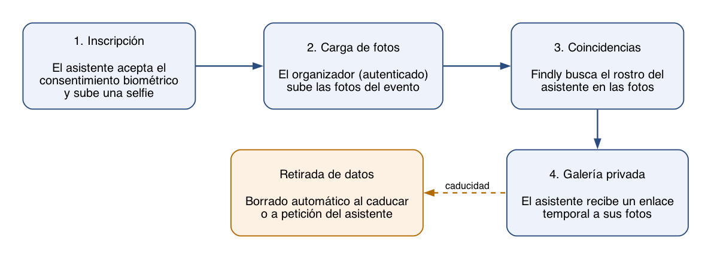
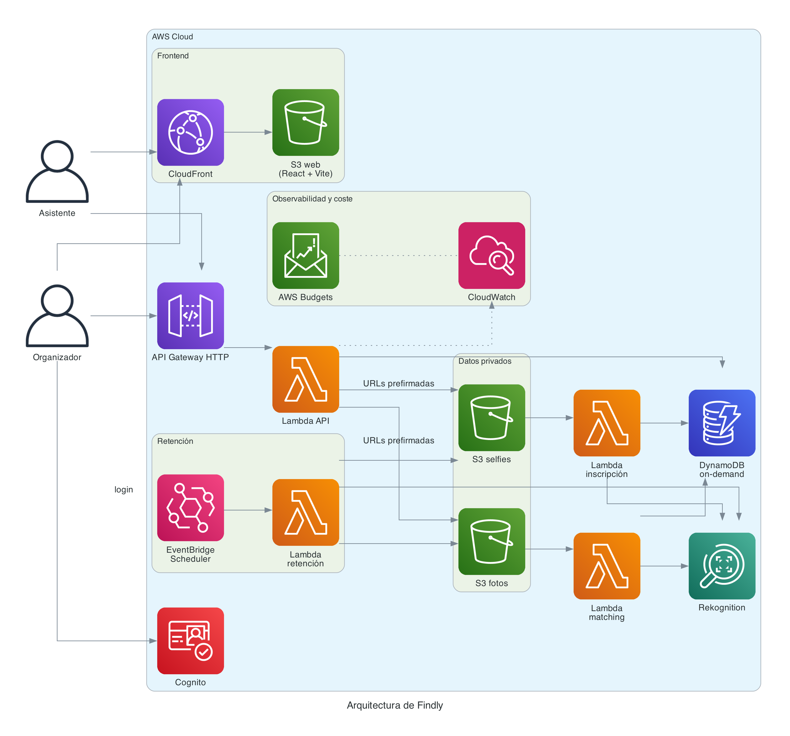
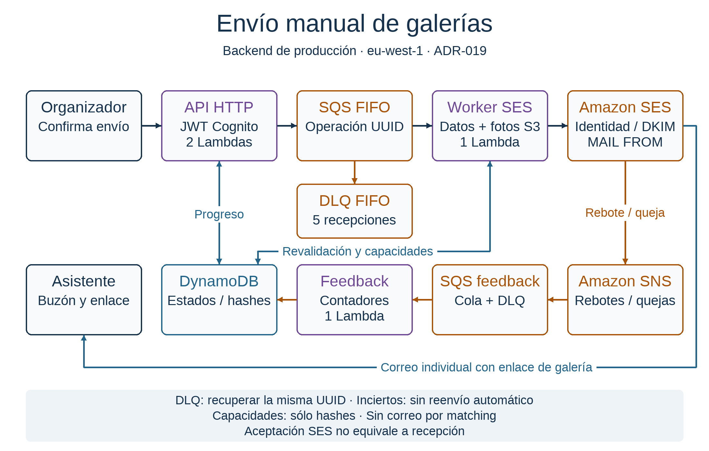

<!--
Compilar (recomendado): make pdf   /   make docx   (ver Makefile)

Compilar a mano:
  pandoc memoria-postgrado.md -o memoria.pdf --pdf-engine=xelatex \
    --filter pandoc-crossref --include-before-body=portada.tex
  pandoc memoria-postgrado.md -o memoria.docx \
    --filter pandoc-crossref --include-before-body=portada.tex

`include-before-body` debe pasarse como flag de línea de comandos, no como
clave del YAML: como metadato no inserta el fichero.

Imágenes: {#fig:id}
Regenerar diagramas: make diagrams (requiere graphviz y el venv de requirements.txt)
-->

# Introducción

## Contexto y problema

En cualquier evento con un número apreciable de asistentes —una jornada
profesional, una boda, una carrera popular, un festival— se generan
rápidamente miles de fotografías repartidas entre varios fotógrafos y
cámaras. El problema que ese volumen plantea no es técnico en origen sino de
usabilidad: cada asistente aparece disperso en un puñado de esas fotos, pero
localizarlas exige revisar manualmente carpetas enteras, confiar en que
alguien las etiquete a mano o resignarse a no encontrarlas nunca. Las
soluciones habituales —enviar un enlace a todo el álbum, pedir que cada
persona busque su propia cara entre cientos de imágenes, o compartir
carpetas abiertas sin ningún control de acceso— no escalan y, además, tratan
como públicas fotografías que contienen datos personales de terceros.

Findly nace para resolver ese problema concreto con una propuesta de valor
sencilla: si un asistente acepta explícitamente que su rostro se use para
este fin y aporta una fotografía de referencia (una selfie), el sistema
puede indexar ese rostro, compararlo automáticamente contra las fotos que el
organizador del evento vaya subiendo, y entregar a esa persona —y sólo a
ella— un enlace privado y temporal con las imágenes en las que aparece. El
consentimiento no es un trámite legal añadido a posteriori: es la condición
que habilita todo el flujo. Sin selfie y sin aceptación explícita del
tratamiento biométrico, no hay indexación ni búsqueda posible.

La segunda motivación del proyecto, inseparable de la primera, es demostrar
que este tipo de servicio puede construirse en la nube pública con una
arquitectura que no obligue a pagar por capacidad reservada ni a operar
infraestructura propia. Un evento es, por definición, una carga de trabajo
puntual y de corta duración: tiene sentido que el coste de la plataforma seaa
proporcional al uso real que hace de ella, no una factura fija mensual
independientemente de si hay un evento activo o no.

## Alcance del MVP

El producto mínimo viable de Findly cubre el recorrido completo de un
asistente y de un organizador de evento, desde la inscripción hasta el
borrado de los propios datos:

- Un asistente accede a la página pública de un evento, acepta el
  consentimiento biométrico y de términos, y sube una selfie mediante una
  URL de carga firmada de un solo uso.
- Una función Lambda indexa el rostro en Amazon Rekognition y expone el
  estado de la inscripción mientras el navegador lo consulta por sondeo.
- Un organizador, autenticado contra un sistema de identidad propio del
  evento, crea el evento y carga las fotografías a medida que las va
  teniendo disponibles.
- El sistema compara cada fotografía nueva contra los rostros inscritos y
  construye, para cada asistente, una galería privada de coincidencias.
- El asistente recibe un enlace temporal a su galería y puede, en cualquier
  momento, solicitar la retirada completa de sus datos.

Estas capacidades se validan contra un conjunto de métricas de éxito
cuantitativas (sección de requisitos no funcionales), se limitan a una única
región de AWS y se diseñan desde el principio para operar dentro de los
límites de la capa gratuita o de un presupuesto de demostración acotado, sin
ningún componente de coste fijo por hora. Todas las imágenes usadas durante
el desarrollo y las pruebas son sintéticas o han sido aportadas con
autorización explícita del equipo: en ningún momento se han tratado
fotografías reales de terceros sin consentimiento.

## Elementos excluidos del alcance

Un proyecto de este tipo invita a ampliarse en direcciones que, aunque
técnicamente posibles, cambiarían su naturaleza o su perfil de riesgo de
forma que el equipo decidió excluir explícitamente desde el planteamiento
inicial:

- Vigilancia o reconocimiento facial en vídeo en tiempo real: Findly sólo
  procesa imágenes fijas subidas voluntariamente, nunca una transmisión de
  cámara continua.
- Tratamiento de menores de edad sin consentimiento explícito documentado de
  su tutor legal.
- Alta disponibilidad multirregión o cualquier garantía de continuidad de
  servicio propia de un sistema de producción crítico.
- Bases de datos relacionales gestionadas (RDS), instancias de cómputo
  reservado (EC2), redes privadas virtuales dedicadas (VPC), pasarelas NAT o
  clústeres de orquestación de contenedores (EKS): cualquier componente cuyo
  modelo de facturación incluya un coste fijo por hora, con independencia del
  uso real.
- Comunicaciones masivas por correo electrónico o SMS como mecanismo de
  marketing o notificación no solicitada.

Esta exclusión no es una limitación técnica sino una decisión de diseño: deja
fuera del perímetro del proyecto exactamente los componentes que introducirían
coste fijo, mayor superficie de exposición de datos sensibles o un cambio de
naturaleza del servicio hacia la vigilancia.

## Requerimientos del proyecto

### Requerimientos funcionales

El sistema debe cumplir, como mínimo, los siguientes requisitos funcionales:

1. Un asistente puede aceptar el consentimiento biométrico y cargar una
   selfie mediante una URL de Amazon S3 firmada de una sola escritura; una
   función Lambda indexa el rostro en Amazon Rekognition y el estado de la
   inscripción (pendiente de carga, en proceso, inscrito o fallido) queda
   disponible para que el cliente lo consulte por sondeo.
2. Un organizador, autenticado, puede crear eventos y cargar fotografías; una
   función Lambda, desacoplada mediante una cola de mensajería, busca
   coincidencias faciales con un umbral de similitud mínimo exigente.
3. El asistente recibe una galería privada construida con URLs firmadas de
   corta duración y puede solicitar en cualquier momento la retirada
   completa de sus datos —derecho al olvido—, lo que implica borrar el
   registro, las coincidencias encontradas, el token de acceso, la imagen
   original y el identificador facial indexado.
4. Cada evento y los datos que genera caducan según una política de
   retención configurable, con un mínimo de demostración de siete días.

### Requerimientos no funcionales y pilares del Well-Architected Framework

Los requisitos no funcionales de Findly se expresan como una matriz de
métricas de éxito con un umbral cuantitativo y una fuente de telemetría
identificada para cada una, de modo que ninguna de ellas quede como una
aspiración sin forma de comprobarse:

| Métrica                         | Fuente                   | Umbral objetivo                                          |
| ------------------------------- | ------------------------ | -------------------------------------------------------- |
| Inscripción completa            | CloudWatch / DynamoDB    | > 98 % de solicitudes completadas                        |
| Precisión de coincidencia       | Rekognition / DynamoDB   | Similitud >= 95,0 %                                      |
| Procesamiento de selfie         | CloudWatch Metrics       | < 3 s desde la carga en S3 hasta el estado "inscrito"    |
| Respuesta de galería            | CloudFront / API Gateway | p95 < 500 ms                                             |
| Control de presupuesto (FinOps) | AWS Budgets              | 100 % dentro de 0 $ (capa gratuita/sandbox) o 5 $ (demo) |
| Borrado conforme a RGPD         | Registros de auditoría   | 100 % de los datos purgados tras caducidad o solicitud   |

: Matriz de métricas de éxito del MVP {#tbl:metricas}

Más allá de estos umbrales cuantitativos, el proyecto adopta explícitamente
los seis pilares del AWS Well-Architected Framework como marco de diseño, no
como una lista de buenas intenciones genéricas: cada decisión de arquitectura
documentada a lo largo de esta memoria está asociada a uno o varios pilares
concretos.

- **Excelencia operativa.** La base del repositorio estandariza linting,
  tipado estricto en TypeScript y un conjunto único de scripts de
  verificación que se ejecutan igual en local y en integración continua;
  las puertas de calidad automatizadas combinan comprobaciones de tipos,
  pruebas unitarias, pruebas de extremo a extremo y validación de
  infraestructura como código en trabajos paralelos, y un runbook de
  demostración ejecutable paso a paso documenta cómo operar el sistema.
- **Seguridad.** Es, con diferencia, el pilar con más decisiones asociadas:
  el alcance excluye desde el inicio datos de menores y vigilancia masiva;
  el acceso a los buckets de almacenamiento está bloqueado a nivel de
  servicio y sólo se concede mediante URLs firmadas de vida corta; la
  identidad de los organizadores se gestiona con un proveedor de identidad
  gestionado y el autorizador de tokens se valida en la propia puerta de
  entrada de la API, no dentro de cada función; y la integración entre
  GitHub Actions y AWS se autentica mediante un protocolo de identidad
  federada sin ninguna clave de acceso de larga duración almacenada como
  secreto.
- **Fiabilidad.** La ingesta de fotografías se desacopla mediante una cola de
  mensajería con una cola de mensajes fallidos, de modo que un pico de
  carga o un fallo transitorio no provocan pérdida de mensajes; el
  procesamiento de cada rostro es idempotente ante reintentos.
- **Eficiencia del rendimiento.** El modelo de datos usa una única tabla con
  un diseño de tabla única y un índice secundario global que permite
  resolver en tiempo constante la pregunta "¿qué registro corresponde a
  este rostro?", sin recurrir nunca a un recorrido completo de la tabla.
- **Optimización de costes.** Ningún componente de la arquitectura tiene un
  coste fijo por hora: el cómputo, la base de datos, el almacenamiento, la
  pasarela de API y el reconocimiento facial se facturan por uso real, y un
  presupuesto con alertas automáticas vigila que el gasto mensual no supere
  el umbral fijado para cada entorno.
- **Sostenibilidad.** Al facturar y ejecutar por petición, la arquitectura no
  mantiene capacidad de cómputo reservada e infrautilizada a la espera de
  tráfico, a diferencia de un servidor encendido permanentemente; los
  entornos de prueba se destruyen por completo al finalizar cada ejecución
  de integración continua, de modo que no queda infraestructura ociosa entre
  una comprobación y la siguiente.

## Gestión interna del proyecto

### Equipo y roles

El proyecto lo ha desarrollado un equipo de cuatro personas: Anyul Rivas,
Renato Luzuriaga, Martí Fabregat Pous y Santiago Oliver Surinyach. El equipo
optó por un modelo de trabajo colaborativo sin roles fijos diferenciados por
disciplina (por ejemplo, "responsable de infraestructura" o "responsable de
frontend"): cada persona tomaba issues del backlog compartido de principio a
fin, incluyendo su implementación, sus pruebas y la documentación asociada,
en lugar de depender de un reparto estático de funciones. Esta forma de
trabajar se apoya en la disciplina de proceso descrita a continuación —una
spec y una issue claras por tarea— más que en una jerarquía de roles.

### Metodología de trabajo

Cada tarea del proyecto se trabaja siguiendo cuatro fases obligatorias, en
este orden:

1. **Investigación.** Antes de escribir una sola línea, se identifica qué
   especificación técnica gobierna el cambio, se leen sus criterios de
   aceptación y se contrastan explícitamente el flujo afectado, la
   privacidad y retención de datos, el coste y la observabilidad. No se
   inventan requisitos cuando una especificación o una decisión de
   arquitectura ya ya los define.
2. **Plan.** Se redacta y se comparte un plan concreto —objetivo, ficheros y
   recursos que cambiarán, orden de implementación, estrategia de prueba,
   evidencia que se generará y riesgos— antes de tocar código. Cualquier
   cambio que afecte a la arquitectura, a los datos, a los permisos, al
   coste o al comportamiento visible para el usuario espera confirmación
   explícita antes de implementarse.
3. **Implementación.** El código de aplicación se escribe en TypeScript
   estricto, sin el tipo `any` ni supresiones del analizador estático; la
   infraestructura se describe en Terraform reproducible, con cada recurso
   etiquetado por proyecto, entorno, responsable de gestión, centro de coste
   y clase de dato; y las pruebas se actualizan junto con la funcionalidad,
   nunca después.
4. **Sincronización.** Al terminar, se actualiza toda la documentación
   afectada —especificaciones, decisiones de arquitectura, evidencia
   reproducible— para que describa exactamente lo implementado y validado,
   nunca el diseño previo ni trabajo futuro presentado como si ya estuviera
   hecho, y se deja constancia en la propia tarea de qué se ha verificado y
   qué queda pendiente. Una tarea no se da por cerrada cuando el código
   "está listo", sino cuando todos sus criterios de aceptación tienen
   evidencia comprobable.

Todo el trabajo se integra mediante ramas descriptivas (de funcionalidad, de
corrección, de documentación o de mantenimiento) y revisión por pull
request; nunca hay cambios directos sobre la rama principal. Los mensajes de
commit siguen una convención estructurada y verificada automáticamente antes
de que el commit llegue siquiera a crearse.

El hallazgo metodológico más relevante del proyecto surgió a mitad de su
desarrollo: una batería de comprobaciones automáticas en verde no es, por sí
misma, prueba suficiente de que una funcionalidad está realmente terminada.
Una suite de pruebas que sustituye los servicios de AWS por simulaciones en
memoria o por un entorno local emulado puede pasar sin que la funcionalidad
equivalente funcione nunca contra los servicios reales. El equipo introdujo
por ello una auditoría de cierre explícita e independiente, que revisó las
tareas que ya se consideraban terminadas contra sus propios criterios de
aceptación y la evidencia desplegada realmente disponible. Esa auditoría
reabrió varias tareas que tenían toda su integración continua en verde pero
carecían de una ejecución verificada contra AWS real, y forzó su
corrección con pruebas desplegadas de extremo a extremo. La lección práctica
que el equipo extrae de esa experiencia es que una auditoría de cierre
periódica, distinta de la propia implementación autoevaluándose, es lo que
realmente hace cumplir la regla de "sin evidencia no hay cierre" sobre
trabajo que ya se daba por terminado.

### Herramientas de gestión de proyecto

El backlog del proyecto se gestiona íntegramente como incidencias (issues)
de un repositorio de GitHub, con tres piezas que se mantienen sincronizadas
entre sí en todo momento: las especificaciones técnicas, que fijan los
criterios de aceptación y las restricciones de cada capacidad; las propias
issues, que documentan el alcance, la pull request asociada, las
validaciones realizadas y lo que queda pendiente; y un catálogo de evidencia
reproducible —capturas, registros de ejecución y resultados de pruebas— que
respalda cada afirmación. Ninguna de las tres piezas se cierra sin que las
otras dos queden actualizadas, y las decisiones de arquitectura relevantes
se registran aparte, como registros de decisión independientes, numerados y
fechados, de modo que una decisión tomada en un momento del proyecto pueda
consultarse más adelante sin tener que reconstruir el razonamiento desde
cero.

# Cuentas AWS, repositorios y GitOps

## Gestión de AWS

### Cuentas, organización y permisos

Findly opera en una única cuenta de AWS y una única región, `eu-west-1`,
una restricción deliberada que evita la complejidad operativa y el coste
añadido de una arquitectura multirregión que el alcance del proyecto no
necesita. El primer intento de desplegar la infraestructura persistente se
realizó sobre un entorno de laboratorio académico de AWS, que resultó
insuficiente: deniega la creación de buckets de Amazon S3 en `eu-west-1` y
bloquea por política de cuenta la configuración de bloqueo de objetos
(«object lock»), necesaria para el estado remoto de Terraform. El equipo
migró a una cuenta de AWS dedicada, en la que esa misma infraestructura de
arranque se desplegó y se verificó con éxito.

Dentro de esa cuenta, los tres entornos del proyecto —desarrollo compartido,
demostración y producción— están aislados entre sí mediante prefijos y
claves de estado de Terraform independientes, de modo que una operación
sobre un entorno no pueda afectar por error a otro.

### Gestión de usuarios

El proyecto distingue dos planos de usuario completamente distintos. Los
asistentes al evento no tienen ninguna identidad de usuario propiamente
dicha: su autorización para consultar su galería o borrar sus datos se basa
únicamente en la posesión de un token de acceso opaco, sin necesidad de
registrarse. Los organizadores, en cambio, se autentican contra un servicio
de identidad gestionado, con una política de contraseñas exigente. El alta
de nuevos organizadores es exclusivamente por invitación administrativa: no
existe un formulario de autorregistro para el panel de administración. Una
persona ya autorizada solicita la invitación, el servicio de identidad
genera una contraseña temporal y la propia aplicación obliga a establecer
una contraseña definitiva en el primer acceso, sin que la infraestructura
gestionada como código llegue a conocer ni almacenar esa contraseña en
ningún momento.

### Medidas de seguridad implementadas

Las medidas de seguridad de Findly se apoyan en un principio simple y
aplicado de forma consistente: nada se expone por defecto y todo acceso
tiene que concederse explícitamente y con el alcance más estrecho posible.
En la práctica, esto se traduce en que ningún bucket de almacenamiento
admite una política de acceso público —las cuatro banderas de bloqueo de
acceso público de Amazon S3 están activas en todos ellos, junto con cifrado
del lado del servidor por defecto—; en que cada función de cómputo tiene su
propio rol de ejecución, sin permisos compartidos con ninguna otra función;
y en que la integración continua nunca almacena una clave de acceso de AWS
como secreto, sino que intercambia un token de identidad firmado por la
propia plataforma de integración continua por credenciales temporales en
el momento de cada ejecución. Las fotografías y selfies sólo se leen o se
escriben mediante URLs firmadas de vida muy corta, nunca mediante un acceso
directo y permanente al bucket.

## Gestión de GitHub

### Estructura del repositorio y convenciones

El repositorio organiza el código de aplicación, la infraestructura como
código, las pruebas de extremo a extremo y la documentación en directorios
separados y de responsabilidad única, con una convención de nombrado de
ramas según el tipo de cambio —funcionalidad nueva, corrección,
documentación o mantenimiento— y un formato estructurado de mensajes de
commit verificado automáticamente antes de cada commit mediante un gancho
local. Ninguna herramienta de calidad estática —formateador, analizador de
estilo, comprobador de infraestructura o de flujos de trabajo de
integración continua— se salta ni en local ni en remoto: ambos ejecutan
exactamente los mismos comandos.

### Infraestructura como código

Toda la infraestructura de AWS se describe con Terraform, organizada en un
conjunto de módulos reutilizables que un único módulo de alto nivel compone
en una pila completa. Esa pila se reutiliza, con parámetros distintos, desde
siete raíces de Terraform independientes: el arranque único del backend de
estado remoto, los tres entornos persistentes (desarrollo compartido,
demostración y producción), el entorno efímero asociado a cada pull
request, y dos raíces compartidas para la identidad de correo saliente y el
certificado del dominio web. Todas comparten un mecanismo de bloqueo nativo
del propio backend de estado en S3, sin depender de una tabla adicional
para gestionar ese bloqueo.

### Conexión entre GitHub y AWS

La integración entre GitHub Actions y AWS se basa íntegramente en
autenticación federada mediante OpenID Connect: cada ejecución de un flujo
de trabajo recibe de GitHub un token de identidad firmado y específico de
esa ejecución, que AWS intercambia por credenciales temporales a través de
una relación de confianza que compara el emisor exacto de ese token, no
simplemente "que la petición venga de GitHub". Existen roles de IAM
distintos para cada propósito: uno para el entorno efímero de pull request,
con permisos acotados por un prefijo de nombre de recurso y una etiqueta que
marca los recursos como temporales; y uno por entorno de despliegue manual
(desarrollo compartido, demostración y producción), cada uno con su propia
relación de confianza restringida a ese entorno concreto de GitHub.

### Gestión de secretos y variables

Las variables de configuración no sensibles de cada entorno —la región, el
nombre del proyecto, el centro de coste, la clase de dato o el dominio de
origen autorizado— se versionan junto con el código de infraestructura,
porque no suponen ningún riesgo si se hacen públicas; una comprobación
automática impide que se cuele por error un valor sensible en esos
ficheros. Los valores realmente sensibles, como la dirección de correo que
recibe las alertas, se inyectan en el momento de la ejecución y nunca se
versionan. Ninguna credencial de AWS de larga duración llega a existir como
tal: toda autenticación, tanto desde la integración continua como desde una
sesión de desarrollo local, se resuelve con credenciales temporales.

## Ciclo de vida del código y CI/CD

Cada cambio propuesto al repositorio dispara automáticamente un conjunto de
comprobaciones organizadas en flujos de trabajo independientes, cada uno con
una responsabilidad única. Un primer flujo de trabajo ejecuta, en paralelo y
sin tocar AWS, la validación del frontend —tipos, estilo, varios cientos de
pruebas unitarias con medición de cobertura, y la propia compilación—, la
validación de la infraestructura como código, un análisis de seguridad y de
sincronización documental, y una batería de pruebas de extremo a extremo
contra un navegador real. Un segundo flujo de trabajo, reservado a pull
requests internas del propio repositorio, es el único que llega a desplegar
infraestructura real en AWS: aprovisiona un entorno completo y aislado
identificado por el número de esa pull request concreta, ejecuta contra él
un recorrido de aceptación de extremo a extremo con un navegador real, y
destruye el entorno al finalizar —tanto si las pruebas han pasado como si
no—, de modo que ninguna ejecución deja infraestructura olvidada
facturando entre una comprobación y la siguiente. Una pull request sólo se
fusiona a la rama principal cuando todas las comprobaciones obligatorias
están en verde; la fusión en sí la ejecuta automáticamente la propia
plataforma mediante una integración de fusión automática, nunca una persona
pulsando un botón manualmente.

## Estrategia de despliegue

El despliegue a un entorno persistente —desarrollo compartido,
demostración o producción— es siempre una acción manual, disparada de forma
explícita y nunca automática, con una entrada booleana que por defecto
limita la ejecución a generar y validar el plan de cambios sin aplicarlo:
una ejecución "en seco" segura de repetir cuantas veces haga falta. Un
guardián automático lee ese plan en formato estructurado y rechaza la
ejecución si detecta cualquier borrado o sustitución de un recurso ya
existente, o cualquier recurso cuyo modelo de facturación incluya un coste
fijo por hora —la misma lista prohibida que se aplica también al entorno
efímero de pull request—, para que un despliegue manual nunca pueda destruir
por accidente lo que ya existe en un entorno real. Cuando el plan se aplica
y la aplicación web se publica, los activos con huella de contenido en su
propio nombre de archivo se sirven con una política de caché de un año,
mientras que el punto de entrada de la aplicación se sirve sin caché, para
que una nueva versión publicada se vea de inmediato sin tener que esperar a
que expire una caché larga; la invalidación de la distribución de
CloudFront se dispara usando el identificador que la propia infraestructura
como código expone como salida, no una búsqueda posterior por metadato.

# Implementación de la solución

## Flujo del MVP

{#fig:flujo}

La @fig:flujo resume el recorrido completo desde el punto de vista de las
dos personas que interactúan con el sistema. El asistente acepta el
consentimiento biométrico y sube una selfie; el organizador, ya autenticado,
sube las fotografías del evento a medida que las tiene disponibles, sin que
el orden entre ambos pasos sea relevante para el resultado final. Findly
busca de forma asíncrona el rostro de cada asistente inscrito en cada
fotografía nueva, y cuando encuentra una coincidencia la añade a la galería
privada de esa persona. El asistente recibe un enlace temporal a esa
galería y, en cualquier momento, puede solicitar la retirada de sus datos;
esa retirada de datos también ocurre automáticamente cuando el periodo de
retención configurado para el evento caduca, sin que nadie tenga que
solicitarlo.

## Arquitectura de la solución

{#fig:arquitectura}

La aplicación web de Findly es una aplicación de una sola página construida
con React, Vite y TypeScript, servida de forma estática desde un bucket de
Amazon S3 a través de una distribución de CloudFront con control de acceso
al origen: no existe un servidor propio detrás de la web, ni falta
renderizado en servidor para las necesidades de esta aplicación. Toda la
interacción dinámica —inscripción, sondeo de estado, galería, administración
de eventos— pasa por una única pasarela de API HTTP que invoca funciones de
cómputo sin servidor; no hay un balanceador de carga propio ni un contenedor
de larga duración en ningún punto de la arquitectura. El estado
transaccional de toda la aplicación vive en una única tabla de base de
datos no relacional facturada por petición, y las imágenes —selfies y
fotografías de evento— se almacenan en un bucket privado que nunca admite
acceso público.

Como se observa en la @fig:arquitectura, la cadena de componentes se activa
mediante eventos nativos de la plataforma en lugar de mediante sondeo
continuo de un proceso propio: al depositarse un objeto en el bucket de
cargas, el propio servicio de almacenamiento dispara una notificación que se
enruta, según el sufijo del nombre del objeto, bien directamente a la
función que indexa selfies, bien a una cola de mensajería que amortigua los
picos de fotografías de evento antes de que la función de comparación
facial las procese. La purga de datos por caducidad se dispara, de la misma
manera, por un planificador de eventos que invoca directamente a la función
de retención según una expresión periódica, sin ninguna cola intermedia. La
observabilidad y el control de coste se superponen a toda la arquitectura
sin intervenir en el camino crítico de ninguna petición: cada componente
escribe sus propios registros estructurados, un servicio de alarmas vigila
condiciones concretas —por ejemplo, que la cola de mensajes fallidos reciba
al menos un mensaje— y un servicio de presupuestos vigila el gasto real de
la cuenta, ambos notificando a un único canal de alertas cuando corresponde.

## Frontend y distribución

La decisión de construir la interfaz con React, Vite y TypeScript, en lugar
de un framework con renderizado en servidor, responde a que la aplicación no
necesita servir contenido indexable por buscadores ni personalizar la
primera respuesta por usuario: toda la lógica de negocio ya vive detrás de
la API, y la interfaz es, en esencia, un cliente de esa API. Esto permite
distribuir la aplicación entera como ficheros estáticos inmutables desde un
bucket privado, servido exclusivamente a través de una distribución de
CloudFront que firma cada petición hacia el origen: el bucket nunca admite
una petición que no provenga de esa distribución concreta. Las rutas
propias de la aplicación —que no existen como ficheros reales en el
bucket— se resuelven redirigiendo las respuestas de error de "no encontrado"
hacia el punto de entrada de la aplicación, que es quien realmente
interpreta la ruta en el navegador.

## Identidad y acceso de organizadores

El panel de administración de eventos exige que el organizador se autentique
contra un servicio de identidad gestionado, con una política de contraseñas
exigente y sin ningún secreto de cliente embebido en el propio navegador. El
token de sesión que ese servicio emite se adjunta a cada petición a las
rutas administrativas de la API, y su validez se comprueba mediante un
autorizador nativo de la propia pasarela de API, no dentro del código de
cada función: una ruta mal configurada falla de forma cerrada en la puerta
de entrada, antes de que ninguna lógica de negocio llegue a ejecutarse. El
alta de nuevas personas organizadoras es exclusivamente por invitación de
alguien ya autorizado, nunca por autorregistro público.

## API y procesamiento

Toda la interacción dinámica de Findly pasa por una única pasarela de API
HTTP que enruta cada petición a una función de cómputo sin servidor
dedicada a esa responsabilidad concreta: descubrimiento de eventos públicos,
inscripción y consentimiento, sondeo de estado, informes de error desde el
propio cliente, consulta de la galería privada, solicitud de borrado, y un
conjunto de rutas administrativas protegidas para la gestión de eventos y
la carga masiva de fotografías. Cada función tiene una única entrada y una
única salida bien definidas: toda respuesta de error, sin excepción, sigue
el mismo formato con un código, un mensaje y un identificador de petición,
de modo que ningún error llegue a exponer información interna del sistema
ni detalles de implementación al navegador.

## Datos, imágenes y reconocimiento facial

### DynamoDB

El modelo de datos de Findly usa una única tabla de base de datos no
relacional, con un diseño de tabla única: eventos, inscripciones,
fotografías, coincidencias y tokens de galería conviven en la misma tabla,
diferenciados por el prefijo de sus claves de partición y de ordenación. Un
índice secundario global permite resolver en tiempo constante la pregunta
"¿a qué inscripción corresponde este rostro indexado?" sin tener que
recorrer la tabla entera, y un segundo índice permite listar los eventos de
un organizador ordenados por fecha sin necesidad de un recorrido completo
tampoco para esa consulta. Ninguna función de la aplicación ejecuta un
recorrido completo de la tabla: la primera versión de la función de purga
por retención sí lo hacía, y se corrigió para usar el mismo índice de
eventos que ya empleaba el listado de administración, filtrando en memoria
únicamente los eventos cuyo periodo de retención ya ha vencido.

### Buckets S3 privados y URLs prefirmadas

Las imágenes —selfies y fotografías de evento— se organizan en el bucket
privado de cargas con una estructura de claves que distingue ambos tipos de
objeto mediante su sufijo, de modo que un mismo prefijo de evento pueda
alimentar dos flujos de notificación distintos sin ambigüedad. Todo acceso
de lectura o escritura a ese bucket se concede exclusivamente mediante URLs
firmadas de vida corta, nunca mediante una política de acceso público ni
una credencial compartida. Las selfies añaden una restricción adicional que
ninguna otra carga tiene: la propia escritura en S3 se condiciona a que el
objeto no exista todavía, de modo que un intento de sobrescribir una selfie
ya subida es rechazado por el propio servicio de almacenamiento, sin
depender de una comprobación de aplicación que pudiera evitarse.

### Amazon Rekognition

El reconocimiento facial se apoya en Amazon Rekognition, con una corrección
de diseño que resultó relevante durante el desarrollo: la llamada más
directa para comparar una imagen de entrada contra una colección de rostros
indexados sólo evalúa el rostro más prominente de esa imagen, un
comportamiento documentado del propio servicio y no una opción de
configuración. Para una fotografía de evento con varias personas —el caso
habitual— esa llamada dejaría sin intentar la comparación del resto de
rostros presentes. La implementación evita esa limitación indexando
temporalmente cada rostro detectado en la fotografía, buscando
coincidencias para cada uno de ellos por separado, y borrando después ese
índice temporal, a costa de varias llamadas al servicio por cada fotografía
en lugar de una sola. Las colecciones de rostros se aíslan por entorno y por
evento, de modo que un fallo de configuración en el entorno de desarrollo
nunca pueda consultar o borrar rostros del entorno de demostración o de
producción.

## Retención y ciclo de vida de los datos

Cada evento tiene asociado un periodo de retención configurable, con un
mínimo de demostración de siete días. Un planificador de eventos dispara
periódicamente una función que consulta qué eventos han superado ese
periodo y, para cada uno de ellos, borra la colección de rostros asociada en
Rekognition y todos los objetos del bucket de cargas bajo el prefijo de ese
evento. Además de esta purga automática por caducidad, cualquier asistente
puede solicitar en cualquier momento, de forma explícita, la retirada
inmediata de sus propios datos: esa operación borra, en una secuencia
pensada para repetirse sin error si falla a mitad de camino, el rostro
indexado, la imagen original, y el registro, las coincidencias y el token
asociados en la base de datos. Tras ese borrado, el mismo enlace de galería
que la persona recibió deja de funcionar.

## Entorno de desarrollo local

El desarrollo y la integración de Findly admiten tres modos de ejecución
local, cada uno con un alcance de prueba explícito para no confundir lo que
cada uno realmente demuestra: un modo totalmente simulado, en el que las
llamadas a los servicios de AWS se sustituyen por dobles de prueba en
memoria; un modo intermedio, que ejecuta los mismos contenedores que
emularían Amazon S3 y DynamoDB en un entorno Docker local, de modo que el
mismo código que se despliega a producción se ejecuta sin cambios contra
esa emulación; y un tercer modo que apunta directamente a una cuenta de AWS
real de pruebas. Ninguno de los dos primeros modos se presenta como
equivalente a una ejecución contra servicios de AWS reales: un conjunto de
pruebas en verde en el modo simulado no acredita, por ejemplo, el
comportamiento real de Amazon Rekognition ni de las notificaciones nativas
de Amazon S3.

## Pruebas

La verificación de Findly combina varios niveles, deliberadamente separados
por lo que cada uno demuestra. Un nivel de pruebas unitarias y de contrato
cubre la lógica de negocio y los constructores de claves de la base de
datos, con una cobertura de línea exigida por encima del 90 % en los
módulos de funciones y de lógica compartida. Un nivel de pruebas de extremo
a extremo con un navegador real cubre tanto el recorrido simulado como el
recorrido contra el entorno local emulado, y un nivel intermedio ejercita la
función de indexación de selfies directamente contra ese mismo entorno
emulado sin pasar por un navegador. El nivel con mayor peso probatorio, sin
embargo, es la ejecución de aceptación desplegada contra un entorno de AWS
real y efímero: un recorrido completo con un navegador real que cubre
inscripción, indexación, comparación facial, galería privada y borrado,
acompañado de comprobaciones directas contra la base de datos y contra
Rekognition para confirmar que el borrado realmente ha ocurrido. Esa
distinción —qué nivel de prueba acredita qué afirmación— no es un matiz
menor: una suite de pruebas enteramente simulada en verde no se considera,
en este proyecto, prueba de que el mismo recorrido funciona contra los
servicios de AWS reales.

## Observabilidad

Cada función de cómputo escribe sus registros como una única línea en
formato estructurado, con un identificador de correlación que enlaza la
petición de la pasarela de API, la invocación de la función y, en su caso,
el mensaje de cola que la originó. Esos registros admiten únicamente una
lista cerrada de campos técnicos —identificador de evento, identificador de
fotografía, código de estado, duración, tipo de error— y deliberadamente no
existe ningún campo para nombres, correos electrónicos, tokens de galería ni
identificadores biométricos, de modo que ese tipo de dato sensible no pueda
llegar nunca a los registros por un descuido futuro. Cada función conserva
sus registros durante un periodo acotado, de forma que el almacenamiento de
observabilidad no crezca sin límite. Los errores que ocurren en el propio
navegador durante la subida de la selfie —que va directamente del
navegador al almacenamiento, sin pasar por el servidor— se reportan de
forma explícita y limitada a una ruta de telemetría dedicada, para que
también ese tipo de fallo quede medido sin exponer información sensible.

# Privacidad, seguridad y cumplimiento

## Tratamiento de datos biométricos y consentimiento

El consentimiento biométrico y de términos se exige como un valor
literal, no como un booleano cualquiera: el backend rechaza cualquier
solicitud de inscripción que no incluya exactamente ese valor explícito.
Findly aplica minimización de datos por diseño en lo que respecta a la
selfie: se almacena la imagen original, en un bucket privado y sujeta a la
misma política de retención que el resto de datos del evento, y el
identificador de rostro que devuelve Rekognition —un identificador opaco,
no una representación matemática del rostro ni una copia adicional de la
imagen—. En ningún caso se almacena un vector de características faciales en
la base de datos, ni existe copia de la selfie fuera del bucket privado. El
correo electrónico es obligatorio en las inscripciones nuevas, exclusivamente
para permitir el envío manual de la galería por parte del organizador
cuando así se decida; el envío automático de correos no forma parte del
alcance aprobado del proyecto.

## Envío manual de galerías y estado de verificación

{#fig:correo}

La @fig:correo amplía la arquitectura base con el circuito transaccional de
correo. La solicitud y el estado requieren JWT de Cognito; el worker revalida
la inscripción y las fotos antes de enviar. El feedback actualiza contadores
sin volver a crear datos borrados. El diagrama describe el diseño desplegado;
su recepción y los escenarios de recuperación requieren evidencia aparte.

La ampliación de alcance de la especificación 20 permite que un organizador
autenticado confirme el envío de enlaces de galería a los participantes
vigentes de su evento que conservan consentimiento, correo válido y fotografías
coincidentes disponibles. Cada correo es individual y transaccional: no hay
CC, adjuntos, seguimiento comercial ni envíos automáticos al producirse una
coincidencia. Una nueva confirmación puede reenviar la galería; repetir la misma
operación conserva su identificador para recuperar trabajo sin duplicarlo.

El envío utiliza Amazon SES en eu-west-1 desde funciones de backend, con cola
FIFO y estados durables en DynamoDB. Las capacidades de galería se generan
aleatoriamente; sólo persiste su hash y los enlaces previos conservan su
validez hasta su revocación o caducidad. Rebotes permanentes y quejas se
procesan mediante SNS/SQS. El resultado distingue aceptación por SES, omisión,
fallo e incertidumbre: un resultado incierto no se reenvía automáticamente.
DynamoDB y SES no comparten una transacción; un borrado no puede cancelar una
petición ya en vuelo. Estas limitaciones están documentadas en ADR-019.

El 15 de octubre de 2026 se comprobó en AWS que el acceso de producción SES
estaba concedido, el envío regional habilitado y la identidad del dominio,
DKIM y MAIL FROM verificados. SPF y DMARC estaban publicados; la ruta pública
HTTPS de galería respondía correctamente. El
[plan OIDC 38769498625](https://github.com/upc-malvaviscos/findly/actions/runs/38769498625)
superó las verificaciones y calculó 36 recursos nuevos, 15 modificaciones y
cero borrados, sin aplicar cambios. Esto demuestra preparación regional y de
infraestructura, no recepción ni apertura de un enlace privado.

Después de integrar la [PR #133](https://github.com/upc-malvaviscos/findly/pull/133)
con los cinco checks obligatorios superados, el
[plan revisado](https://github.com/upc-malvaviscos/findly/actions/runs/38780832909)
eliminó el cambio no deseado de remitente de Cognito. El
[despliegue OIDC de producción](https://github.com/upc-malvaviscos/findly/actions/runs/38781070488)
terminó correctamente: 36 recursos creados, 13 modificados y ninguno destruido.
Quedaron habilitados la interfaz de envío, cuatro Lambdas, colas, feedback y
alarmas; HTTPS y la ruta pública de galería superaron su gate. La lectura
posterior de Cognito confirmó que conserva SES. Publicar esta infraestructura
no demuestra por sí solo entrega ni apertura del correo.

La validación del despliegue detectó incompatibilidades en el propio arnés:
la normalización de la URL de API, la comprobación de ausencia de objetos con
permisos S3 limitados, el sufijo de las fotografías y los parámetros de consulta
de logs. Las PR #134, #135 y
[#136](https://github.com/upc-malvaviscos/findly/pull/136) corrigen esos contratos
sin ampliar permisos de producción. La última revisión supera 651 pruebas
locales y los cinco checks obligatorios, incluida la creación y destrucción de
un entorno AWS efímero. Esta evidencia valida las correcciones; la aceptación
sintética en producción y la recepción real se documentan por separado.

La siguiente ejecución alcanzó la operación administrativa, pero el worker
falló antes de enviar. La inspección posterior confirmó la limpieza de los
datos sintéticos y capacidades observadas. Se detectaron dos condiciones
DynamoDB que usaban TTL sin el alias exigido para palabras reservadas; la
PR #137 incorpora la corrección y una regresión que falla antes del cambio.
Sus gates locales completan 653 pruebas y sus cinco checks remotos pasan.
El despliegue OIDC 38808198446 publica la corrección sin altas ni borrados,
con 17 actualizaciones de artefactos. La aceptación posterior
[38808775703](https://github.com/upc-malvaviscos/findly/actions/runs/38808775703)
terminó fallida en el escenario de supresión al rechazar la API de SESv2
las direcciones con caracteres de subaddressing (`+`) y no estar clasificada
la excepción `BadRequestException` en el arnés, lo que interrumpió la limpieza.
La [PR #140](https://github.com/upc-malvaviscos/findly/pull/140) corrigió la
dirección de prueba a `suppression-${runId}@simulator.amazonses.com`, incorporó
el diagnóstico del error y blindó los contratos del manifiesto con nuevas
pruebas unitarias antes de su integración en la rama principal.

Con esa corrección, la repetición sintética en AWS
([run 38950320818](https://github.com/upc-malvaviscos/findly/actions/runs/38950320818))
completó con éxito los nueve escenarios del arnés —entrega normal, rebote,
queja, supresión de cuenta, fallo en el renderizado de plantilla, idempotencia
en DynamoDB y emisión de token de galería— y verificó de forma estricta la
limpieza completa sin dejar recursos residuales en la cuenta.

A continuación, se ejecutó la fase de entrega real a destinatario único
([run 38955016584](https://github.com/upc-malvaviscos/findly/actions/runs/38955016584))
dirigida al buzón autorizado `info@findly.barcelona`. El mensaje transaccional
llegó directamente a la bandeja de entrada principal (`inbox`) sin ser desviado
a correo no deseado (`spam`), satisfaciendo una autenticación criptográfica
estricta:

- **SPF (Sender Policy Framework)**: resultado `pass`. El dominio de retorno
  técnico (`bounce.findly.barcelona`), configurado como subdominio MAIL FROM
  personalizado en Amazon SES, resolvió mediante registro MX a los servidores de
  correo saliente de AWS (`feedback-smtp.eu-west-1.amazonses.com`) y validó
  contra la política SPF `v=spf1 include:amazonses.com ~all`, verificando que la
  dirección IP de origen pertenecía a los rangos autorizados del dominio.
- **DKIM (DomainKeys Identified Mail)**: resultado `pass` con doble firma
  criptográfica. Se validó la firma digital con clave RSA de 2048 bits para el
  dominio organizativo (`d=findly.barcelona`) generada mediante Easy DKIM sobre
  registros CNAME en el DNS corporativo, junto con la firma complementaria de
  1024 bits propia del proveedor (`d=amazonses.com`), garantizando la integridad
  de cabeceras y cuerpo frente a alteraciones en tránsito.
- **DMARC (Domain-based Message Authentication, Reporting, and Conformance)**:
  resultado `pass`. Se comprobó la alineación identificadora estricta entre el
  remitente visible RFC5322 (`From: Findly <info@findly.barcelona>`) y el
  dominio autenticado por DKIM (`findly.barcelona`), bajo la política declarada
  en DNS (`p=reject`/`p=quarantine`), impidiendo vectores de suplantación y
  reforzando la entregabilidad del dominio.

El enlace HTTPS contenido en el correo transportaba la capacidad opaca de
acceso a la galería (`https://www.findly.barcelona/gallery?token=...`). El
usuario abrió el enlace en su navegador, confirmando que la aplicación web
validó el hash SHA-256 en DynamoDB y cargó de forma interactiva la galería
privada con sus fotografías correspondientes, sin exponer datos biométricos ni
información de otros participantes. El arnés procesó el recibo de aceptación
(`FINDLY_EMAIL_ACCEPTANCE_RECEIPT`), concluyó el flujo con éxito y purgó
ordenadamente los datos temporales.

La configuración existente de Cognito en producción utiliza también SES. El
responsable decidió conservarla el 15 de octubre: la infraestructura declara
la identidad regional de la misma cuenta y el remitente acordado, de forma
independiente a la activación de las galerías. Ante la expiración de la
invitación de un administrador del equipo, se procedió a su reemisión mediante
la operación `Cognito AdminCreateUser` con acción `RESEND`, comunicando la nueva
contraseña temporal por canal seguro en cumplimiento del runbook operativo, sin
relajar privilegios IAM ni alterar la configuración de Cognito en producción.

Esta verificación empírica de extremo a extremo permitió dar por satisfechos
todos los criterios de la especificación 20. La
[PR #142](https://github.com/upc-malvaviscos/findly/pull/142) sincronizó la
documentación formal y evidencias, superó los nueve checks obligatorios de CI
(incluyendo el entorno efímero de despliegue y destrucción) y se integró en la
rama principal, cerrando formalmente la issue #86. La issue #98 permanece
abierta para el seguimiento de entregabilidad a largo plazo con dos proveedores
independientes (Google Workspace y Microsoft 365), y la issue #49 continúa
abierta de acuerdo con la gobernanza arquitectural del proyecto. No se
publican direcciones de prueba, tokens, enlaces privados, credenciales ni
datos biométricos reales como evidencia.

## Minimización y retención de datos

Todo recurso de infraestructura se etiqueta, entre otras cosas, con una
clase de dato que distingue los entornos que tratan datos biométricos
reales de los que sólo tratan datos sintéticos, de forma que resulte
auditable qué recursos concretos requieren el nivel más alto de protección
sin tener que inspeccionar su contenido. Dicho esto, el proyecto documenta
también, de forma explícita y sin ocultarlas, varias limitaciones de
privacidad conocidas: el mecanismo de expiración automática de la base de
datos no es un borrado inmediato ni síncrono, sino un proceso en segundo
plano cuyo plazo exacto no está garantizado por el proveedor, de modo que la
garantía real de borrado depende de la función de borrado explícito y de la
función de purga por caducidad, no del mecanismo de expiración en sí; el
consentimiento se registra como un valor y una marca de tiempo únicos, sin
un historial de revocación ni versión; y las colecciones de rostros creadas
antes de que se introdujera el aislamiento por entorno no se migran
automáticamente a ese esquema más seguro.

## Seguridad de acceso a los datos

Ningún bucket de Findly admite jamás una política de acceso público: las
cuatro banderas de bloqueo de acceso público están activas en todos ellos,
con cifrado por defecto del lado del servidor. El acceso a las imágenes se
concede exclusivamente mediante URLs firmadas de vida muy corta, nunca
reutilizables más allá de su vigencia, y el acceso a la aplicación web se
restringe a las peticiones firmadas por la distribución de CloudFront
correspondiente. Cada función de cómputo tiene su propio rol de permisos
mínimos, sin compartir acciones ni recursos más allá de lo estrictamente
necesario para su propia responsabilidad, y el token de acceso a la galería
privada se trata como un dato sensible por sí mismo: ni el token en claro ni
la cabecera que lo transporta llegan nunca a los registros del sistema.

# Costes y FinOps

## Premisas y escenarios

El modelo de coste de Findly se diseñó bajo dos escenarios: un entorno de
desarrollo y pruebas que debe mantenerse dentro de la capa gratuita de AWS,
y un entorno de demostración con un presupuesto máximo de cinco dólares al
mes. Se ha definido un presupuesto a nivel de cuenta que avisa al ochenta
por ciento del umbral, excluyendo créditos y reembolsos del cálculo. Su
configuración está cubierta por planes y contratos; la entrega del canal
SNS se verificó en AWS, pero no se observó el disparo propio de Budgets.
El control diseñado alerta sobre el gasto: no interrumpe ni elimina recursos
al superar el umbral.

## Coste por servicio

### API Gateway y Lambda

La pasarela de API y las funciones de cómputo se facturan exclusivamente por
petición y por duración de ejecución respectivamente, sin ninguna capacidad
reservada de antemano: si no hay tráfico, no hay coste alguno en estos dos
componentes.

### DynamoDB

La base de datos se configura en modo de facturación por petición, sin
capacidad de lectura o escritura aprovisionada por adelantado, de modo que
el coste escala directamente con el volumen real de operaciones y de
almacenamiento.

### S3 y CloudFront

El almacenamiento de imágenes y de los ficheros estáticos de la aplicación
web se factura por gigabyte almacenado y por petición; la distribución de
contenido a través de CloudFront se factura por transferencia de datos y
por petición, sin ningún compromiso mínimo de capacidad.

### Rekognition

El reconocimiento facial se factura por imagen procesada, tanto en la
indexación de selfies como en cada comparación de fotografía de evento;
dado que cada fotografía con varias personas requiere varias llamadas al
servicio, este es uno de los componentes cuyo coste crece más directamente
con el volumen de fotografías del evento, aunque sigue sin tener ningún
componente fijo.

### Correo transaccional

El envío manual añade consumo de SES por mensajes y datos enviados, junto
con las invocaciones Lambda y peticiones SQS/SNS que coordinan la operación
y su feedback. La implementación no solicita IP dedicadas ni complementos
de entregabilidad. El importe depende del plan regional y del uso según
las [tarifas oficiales de SES](https://aws.amazon.com/ses/pricing/); esta
aceptación no aporta una medición del coste de facturación.

### CloudWatch y otros servicios

Los registros de observabilidad generan consumo por ingestión y
almacenamiento, acotado por su retención. Las alarmas se facturan por las
horas durante las que existen, sujetas a las condiciones de capa gratuita;
pueden generar consumo aunque no haya tráfico de usuarios. La cola y el
planificador añaden sus peticiones y ejecuciones. Las condiciones vigentes
se detallan en las [tarifas de CloudWatch](https://aws.amazon.com/cloudwatch/pricing/).

## Coste total

El coste total combina ejecuciones, peticiones y envíos con almacenamiento
persistente y observabilidad. La arquitectura evita servidores y capacidad
de cómputo aprovisionada; los objetos conservados en
[S3](https://aws.amazon.com/s3/pricing/), los registros retenidos y las
alarmas pueden generar consumo durante periodos sin usuarios activos. El
importe depende también de la región, el plan y la capa gratuita aplicable.
Al 15 de octubre de 2026 no se han contrastado los importes con una factura
real ni con una estimación completa de la calculadora de AWS para el correo
desplegado. Las cifras de diseño son objetivos presupuestarios y órdenes de
magnitud, pendientes de esa comprobación.

## Control de costes

El diseño del control de coste combina tres mecanismos: un presupuesto
a nivel de cuenta previsto para avisar antes de superar el umbral de cada
escenario; un etiquetado obligatorio de todo
recurso de infraestructura por proyecto, entorno, responsable de gestión,
centro de coste y clase de dato, que permite atribuir el gasto real a su
origen; y la destrucción completa y automática de cada entorno de prueba
asociado a una pull request al finalizar su verificación, de modo que
ninguna ejecución de integración continua deje infraestructura facturando
entre una comprobación y la siguiente.

# Conclusiones

## Principios de arquitectura de este proyecto

A lo largo de esta memoria, cada pilar del AWS Well-Architected Framework se
ha traducido en acciones concretas, no en una declaración de intenciones:

- **Excelencia operativa**: un único conjunto de comprobaciones de calidad
  se ejecuta igual en local y en integración continua, y una auditoría de
  cierre independiente —más allá de los propios checks automáticos— resultó
  necesaria para confirmar que el trabajo dado por terminado realmente lo
  estaba.
- **Seguridad**: ningún almacenamiento es público, ninguna credencial de AWS
  de larga duración se almacena como secreto, cada función de cómputo
  dispone de los permisos mínimos para su propia tarea, y la identidad de
  los organizadores se separa completamente de la capacidad de acceso de los
  asistentes.
- **Fiabilidad**: la ingesta de fotografías está desacoplada mediante una
  cola de mensajería con cola de mensajes fallidos, y las operaciones más
  sensibles del sistema —el borrado de datos de un asistente— se diseñaron
  para ser repetibles sin error ante un fallo parcial.
- **Eficiencia del rendimiento**: el modelo de datos resuelve en tiempo
  constante las dos consultas más frecuentes del sistema —qué inscripción
  corresponde a un rostro y qué eventos administra un organizador— sin
  recorrer nunca la tabla completa.
- **Optimización de costes**: ningún componente de la arquitectura tiene un
  coste fijo por hora, y un presupuesto automático con alertas vigila el
  gasto real en todo momento.
- **Sostenibilidad**: al facturar y ejecutar por petición, el sistema no
  mantiene capacidad de cómputo reservada e infrautilizada, y cada entorno
  de prueba se destruye por completo al terminar de usarse.

Dicho esto, esta memoria no presenta el proyecto como una implementación
cerrada y exenta de limitaciones: varios recorridos quedan verificados
únicamente de forma estática o en un entorno de prueba efímero, y
cuestiones como el disparo real del planificador de purga por caducidad, la
confirmación real de una alerta de presupuesto o la entrega y apertura de
correos en dos proveedores distintos deben contrastarse con su evidencia
específica. La publicación HTTPS comprobada no demuestra por sí sola el
recorrido de una galería privada recibida por correo.

## Mejoras para una fase II

Una continuación natural del proyecto debería, por orden de prioridad:

1. Verificar en un entorno de AWS real y persistente el disparo efectivo del
   planificador de purga por retención, la alerta real de presupuesto y la
   recepción de un correo de alerta confirmado, en lugar de validarlos sólo
   de forma estática.
2. Completar la aceptación del correo de galerías sobre el despliegue
   persistente ya publicado: recuperación, feedback y recepción/apertura en
   dos proveedores distintos. La prueba parcial con un solo buzón conserva
   ese último requisito abierto y no demuestra un crash original durante
   el envío ni la cancelación de una petición SES que ya esté en vuelo.
3. Decidir y documentar formalmente la migración de las colecciones de
   reconocimiento facial creadas antes de introducirse el aislamiento por
   entorno hacia el esquema de nombrado más seguro.
4. Revisar si el modelo de datos actual, basado en una base de datos no
   relacional de tabla única, sigue siendo adecuado a medida que el sistema
   necesite consultas inversas más complejas —por ejemplo, encontrar todas
   las coincidencias de una fotografía concreta de forma eficiente— o si
   conviene migrar a una base de datos relacional, decisión que este
   proyecto deja explícitamente abierta y pendiente de un análisis
   comparativo medido.
5. Fuera del alcance de este trabajo académico y sin planificación prevista
   quedan, de forma deliberada: una revisión legal formal de protección de
   datos, campañas de marketing por correo o SMS, el
   escalado a más de un evento concurrente, y la operación en producción
   con soporte continuo.

# Referencias

1. Amazon Web Services. _Amazon Rekognition Developer Guide — IndexFaces_.
   <https://docs.aws.amazon.com/rekognition/latest/dg/API_IndexFaces.html>.
2. Amazon Web Services. _Amazon Rekognition Developer Guide — SearchFaces_.
   <https://docs.aws.amazon.com/rekognition/latest/dg/API_SearchFaces.html>.
3. Amazon Web Services. _Amazon S3 User Guide — Uploading and copying objects
   using presigned URLs_.
   <https://docs.aws.amazon.com/AmazonS3/latest/userguide/PresignedUrlUploadObject.html>.
4. Amazon Web Services. _Amazon DynamoDB Developer Guide — Global secondary
   indexes_.
   <https://docs.aws.amazon.com/amazondynamodb/latest/developerguide/GSI.html>.
5. Amazon Web Services. _Amazon DynamoDB Developer Guide — Time to Live
   (TTL)_.
   <https://docs.aws.amazon.com/amazondynamodb/latest/developerguide/TTL.html>.
6. Amazon Web Services. _Amazon EventBridge Scheduler User Guide_.
   <https://docs.aws.amazon.com/scheduler/latest/UserGuide/what-is-scheduler.html>.
7. Amazon Web Services. _Amazon CloudWatch Logs User Guide — Working with log
   groups and log streams_.
   <https://docs.aws.amazon.com/AmazonCloudWatch/latest/logs/Working-with-log-groups-and-streams.html>.
8. Amazon Web Services. _AWS Budgets User Guide_.
   <https://docs.aws.amazon.com/cost-management/latest/userguide/budgets-managing-costs.html>.
9. Amazon Web Services. _Amazon Cognito Developer Guide — User pool
   authentication flows_.
   <https://docs.aws.amazon.com/cognito/latest/developerguide/amazon-cognito-user-pools-authentication-flow.html>.
10. Amazon Web Services. _Amazon API Gateway Developer Guide — Working with
    HTTP APIs_.
    <https://docs.aws.amazon.com/apigateway/latest/developerguide/http-api.html>.
11. Amazon Web Services. _Securing Amazon S3 static website content using
    CloudFront Origin Access Control_.
    <https://docs.aws.amazon.com/AmazonCloudFront/latest/DeveloperGuide/private-content-restricting-access-to-s3.html>.
12. GitHub, Inc. _Configuring OpenID Connect in Amazon Web Services_.
    <https://docs.github.com/en/actions/deployment/security-hardening-your-deployments/configuring-openid-connect-in-amazon-web-services>.
13. HashiCorp. _Terraform — Backend Type: s3 (native S3 locking)_.
    <https://developer.hashicorp.com/terraform/language/backend/s3>.
14. Amazon Web Services. _AWS Well-Architected Framework — Cost Optimization
    Pillar_.
    <https://docs.aws.amazon.com/wellarchitected/latest/cost-optimization-pillar/welcome.html>.
15. Amazon Web Services. _AWS Well-Architected Framework — Security Pillar_.
    <https://docs.aws.amazon.com/wellarchitected/latest/security-pillar/welcome.html>.
16. Amazon Web Services. _AWS Well-Architected Framework — Sustainability
    Pillar_.
    <https://docs.aws.amazon.com/wellarchitected/latest/sustainability-pillar/welcome.html>.
17. Amazon Web Services. _Amazon SQS Developer Guide — Amazon SQS
    dead-letter queues_.
    <https://docs.aws.amazon.com/AWSSimpleQueueService/latest/SQSDeveloperGuide/sqs-dead-letter-queues.html>.
18. Amazon Web Services. _AWS Lambda Developer Guide — Asynchronous
    invocation_.
    <https://docs.aws.amazon.com/lambda/latest/dg/invocation-async.html>.
19. HashiCorp. _Terraform — AWS Provider documentation_.
    <https://registry.terraform.io/providers/hashicorp/aws/latest/docs>.
20. Microsoft. _Playwright — a framework for web testing and automation_.
    <https://playwright.dev/>.
21. Vitest team. _Vitest — a Vite-native testing framework_. <https://vitest.dev/>.
22. Evan You et al. _Vite — Next Generation Frontend Tooling_. <https://vite.dev/>.
23. Conventional Commits. _Conventional Commits v1.0.0 specification_.
    <https://www.conventionalcommits.org/en/v1.0.0/>.
24. Parlamento Europeo y Consejo de la Unión Europea. _Reglamento (UE)
    2016/679 (Reglamento General de Protección de Datos)_.
    <https://eur-lex.europa.eu/eli/reg/2016/679/oj>.
